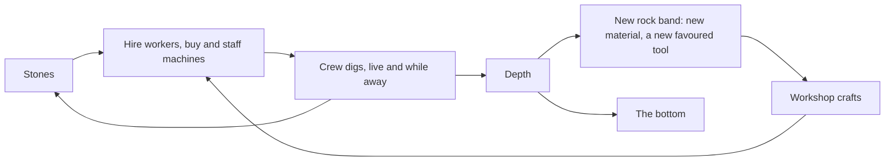

# Design intent

Why each part of the game exists, and what the screens should make the player feel. Confirmed by Flemming on Oct 22, 2026. `docs/DESIGN.md` holds the numbers and the milestone history; this page holds the reasons.

## The first evenings: why the game changed (#664)

Since #664 the phone plays slice 1's part 1, the start of the road to Mars. It is an engineering game: no tapping the rock, no relics to hunt, no hand-off to a kid. Flemming wanted a game whose answer is never told (the discovery principle, 15 Nov 2026): the page shows the numbers (what each stage moves, what each worker and machine adds, how the piles between the stages fill and empty) and he does the maths. The parts exist for these reasons:

- **One worker at the start, moved by hand.** The first evening is about seeing the line: drilled rock waits until he moves the worker to haulage, and at the shaft until he moves him to hoisting. Each hire must feel like a difference (15 Nov 2026).
- **A pile between the stages.** The stages never run in step (15 Nov 2026): each has its own room, so a stage that stands is visible on its row, and moving or hiring for it is a decision with a number on it.
- **An order the city builds.** The Light Tower is the first goal: he orders it, wagons carry the stone, builders put it up, and its roof lifts the night shift. Transport and builders are the second line to balance.
- **The night as a shift.** Closing the phone is a night shift at 30% for eight hours; the shift report tells what it made. Close is still pause, and nothing is lost.

- **The refinery shows the flow, not the answer (#671).** The rock comes up into the hopper, the kilns take what they can make into brick, and the rest runs down the bypass to stone; the stockyard's two bays fill in sight. The page gives each rate and room, and how long a night lasts now, so he works out the next kiln or the next expansion himself. The shift report names when each stockpile filled, never what to buy.
- **The stockyard ends the night, not a clock (#672).** Once the refinery opens, a night runs until the stockyard is full, so its room is the second thing he plans for before closing the phone: a bigger stockyard is a longer night. The Warehouse, part 2's order, takes brick as well as stone, so the kilns matter to the city, and its roof doubles the stockyard.

The sections below are the reasons for the game before #664, kept until its clean-up (#665). #728 took the dig, the relics, golden veins, the Gold rush and the boosts out of that game too, and the parts below no longer name them.

## The core loop and the story

A dad starts with one worker in front of a mountain far too big to dig. He builds a crew, learns the mountain, and in the end reaches the bottom (until #729 he then passed the mine to his kid). The size of the mountain is the point: it makes automation necessary, the Cookie Clicker premise. Costs grow faster than output, so the next goal is always just in reach (Pecorella). The player learns by doing, in small loops of action and feedback (Dan Cook).

Two sessions, two feelings:

- **2 minutes, a check-in:** "My crew kept going without me." See what was dug, spend the return on a few good buys, leave feeling ahead. Leaving is never punished. Buys' ×10 and Max key (#358) keeps that shopping to a handful of taps: a check-in buys 9 to 63 things, which one at a time would be a chore.
- **30 minutes, a sitting:** "I'm running a dig site." Staff the machines, craft at the workshop, send engineers exploring, pick upgrades, get ready for the next rock band.

## Why each system exists

| System                                   | Why it exists                                                                                                        | The decision it creates                           | What the screen should make him feel                                                                    |
| ---------------------------------------- | -------------------------------------------------------------------------------------------------------------------- | ------------------------------------------------- | ------------------------------------------------------------------------------------------------------- |
| Workers                                  | The first automation, the people of the dig                                                                          | One more worker, or save for a machine            | These are my people                                                                                     |
| Carts, drills, borers, the Great Machine | Bigger tools for a bigger mountain                                                                                   | Which machine next, and are there hands to run it | Machines are crew you staff                                                                             |
| Upgrades                                 | Lasting gains, building for later                                                                                    | A permanent gain now, or the next machine         | This makes everything after better                                                                      |
| Workshop and materials                   | Each band gives its own material, and the bench turns it into tools                                                  | What to craft, and when to start a timer          | Each layer gives me something to build with                                                             |
| Engineers and expeditions                | Named people who grow, a job for the middle game                                                                     | Tend a machine, or explore for a find             | My best people grow and go exploring                                                                    |
| Rock bands and hazards                   | The mountain changes as you go down, and the mine window shows each band's own view; trouble shows in the window too | Which tool suits this band; fix trouble now       | Each layer asks for a new tool; trouble needs a hand, not a penalty                                     |
| Time away                                | Life comes first                                                                                                     | None; it's a gift                                 | The mountain waited, and my crew kept going. After a night away, the mountain dreamt of something below |

Tapping, boosts and the relics had rows here until #728 deleted them, and passing to the kid until #729.

## Where the game breaks its own theory today

Measured by the strategy lab on today's mountain (main at 77d4599, 20 seeds), before #737 moved the lab to the fresh mine. Every new thing should come with a reason, a moment and a first use in the same sitting. Today:

- **Clay waits a day.** First clay comes at day 0.5; the workshop opens at day 1.5. Nothing can use clay before then.
- **The favoured machine comes late.** Granite hardness actually favours drills, and the screen never says which machine suits a band. The 9M borer is affordable only 2–40% of the way into the Granite, depending on the player.
- **The Great Machine is late.** It's affordable 48–69% of the way through the Crystal.
- **Upgrades appear with no trigger.** They unlock silently behind a button with no badge.
- **Kid runs get shorter** (5.5 → 4.5 → 3.5 days). Each run should be longer than the last. (Kid runs went in #729.)

## The reveal pattern (M11)

Every system announces itself, explains itself in one or two lines, guides one first use, and keeps a "How it works" card one tap away:

1. **Trigger:** a red dot lamp on its key's cap (#373) and a one-line "New" note.
2. **Reveal card:** a title, one or two lines, and one big button that does the first action.
3. **Guided first use:** the target is highlighted until it's done once, then a short payoff line.
4. **Info button:** in the same corner of every sheet, one screen of "How it works", no scroll.

Help comes at the moment of need, not as an up-front tutorial (NN/g).

## The choices are the game

The choices are the game. Real numbers let the player reason for himself. A number that does the reasoning for him removes the choice.

**Numbers rule:**

- Show real numbers: the price, what one more adds, workers needed and workers free.
- **Never** show payback, expected gain, best-value or time-to-afford.
- Discoveries stay vague: expedition finds, hazards, what comes next.
- No "?" in player text.

One written exception (decision D1, #372): the Ready now plate's Saving for time, "in 4m", is the time until the pocket reaches the price at the current speed, rounded up to the minute, and to the second in its last minute, so a cart three seconds away never reads "in 1m" (#517). It shows only on that plate, and never at zero speed. Nor does it show when the price is more than the pocket plus the stones left: the mountain runs out first, so the plate says "Saving for …" with no time (#610).

**A choice must not be obvious.** If every option grows the same way, the best buy is a single sort and the other buttons are scenery. Before #356 every machine added a fixed output and doubled in price (it now climbs a gentle curve, and the deeper bands dig more stones per stone of depth; [Numbers now](DESIGN.md#numbers-now)), so "cheapest output per stone" is always the answer. The lab agrees: the same move is best 25–47% of the time, and boosts and crafts are almost never the best move.

What makes a decision interesting (Sid Meier): there is a trade-off, the situation decides, and the player can read the consequences. The cures for a dominant strategy are trade-offs on several axes, feedback loops, and shared scarce resources (Adams and Dormans; Machinations). Idle games do it with growth curves that differ, synergies, milestones and prestige (Pecorella; Cookie Clicker; AdVenture Capitalist).

## The seven adopted mechanisms

Each one stays readable from the real numbers on the card.

1. **Lab measures, report-only.** Decision entropy (how often the top play styles disagree on the best move) and greedy regret (how far behind a "cheapest output per stone" bot finishes).
2. **Layer-favoured machines.** Each band boosts one tool and slows another. The layer card names it ("The Granite suits drills"). Which machine each band favours is decision D3, which needs Flemming's OK.
3. **Ownership milestones (built, #357).** Marks on every machine tier and on workers make each of that tier dig twice as fast, so an older machine stays worth a look. Shown as "N of 10" and the payoff ("Every cart hauls twice as fast.").
4. **A contested worker pool.** Machines, tending, crafts and repairs all draw on the same free workers. Shown as "Needs 8 workers · 5 free".
5. **Short and long crafts.** A strong short timer and a gentle long one, so the right pick depends on the session. (Boosts were the other half until #728.)
6. **Synergies and material forks.** One tier makes another stronger ("+1% to every drill for each cart"), and each band's material feeds two recipes for different play styles.
7. **Kid-run twists.** Each generation has a bigger mountain, costs that grow faster than the Legacy bonus, and one new rule, so each run is longer and different. (Gone with kid runs in #729.)

The order and the done-when lines are in `docs/plans/next-milestones.md`. Any lab threshold change needs Flemming's OK. Since #737 the lab plays only the fresh mine and judges no guardrail: the old rows judged today's mountain, and the fresh mine's own are not designed yet (Flemming, 16 Nov 2026).

## Sources

- Anthony Pecorella, "The Math of Idle Games", parts [I](https://www.gamedeveloper.com/design/the-math-of-idle-games-part-i), [II](https://www.gamedeveloper.com/design/the-math-of-idle-games-part-ii), [III](https://www.gamedeveloper.com/design/the-math-of-idle-games-part-iii), and GDC 2016 ["Quest for Progress"](https://www.gdcvault.com/play/1023876/)
- [Sid Meier on interesting decisions, GDC 2012](https://www.gamedeveloper.com/design/gdc-2012-sid-meier-on-how-to-see-games-as-sets-of-interesting-decisions)
- Ernest Adams and Joris Dormans, _Game Mechanics: Advanced Game Design_ (2012), and [Machinations](https://machinations.io/docs)
- [Cookie Clicker upgrades](https://cookieclicker.fandom.com/wiki/Upgrades), [AdVenture Capitalist unlocks](https://adventure-capitalist.fandom.com/wiki/Unlocks)
- Dan Cook, ["The Chemistry of Game Design"](https://www.gamedeveloper.com/design/the-chemistry-of-game-design)
- NN/g, [onboarding tutorials](https://www.nngroup.com/articles/onboarding-tutorials/) and [progressive disclosure](https://www.nngroup.com/articles/progressive-disclosure/)
