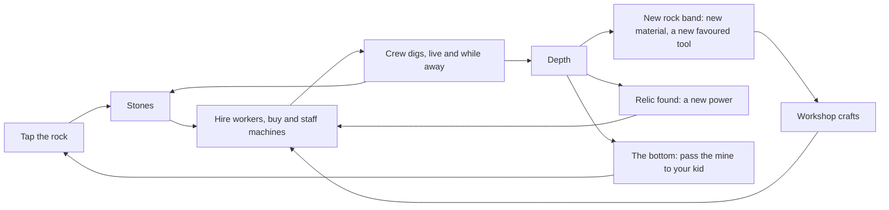

# Design intent

Why each part of the game exists, and what the screens should make the player feel. Confirmed by Flemming on Oct 22, 2026. `docs/DESIGN.md` holds the numbers and the milestone history; this page holds the reasons.

## The core loop and the story

A dad starts with bare hands in front of a mountain far too big to dig. He builds a crew, learns the mountain, finds what the great dads of history left behind, and in the end hands the mine to his kid. The size of the mountain is the point: it makes automation necessary, the Cookie Clicker premise. Costs grow faster than output, so the next goal is always just in reach (Pecorella). The player learns by doing, in small loops of action and feedback (Dan Cook).

Two sessions, two feelings:

- **2 minutes, a check-in:** "My crew kept going without me." See what was dug, make one good buy, maybe tap a vein, leave feeling ahead. Leaving is never punished.
- **30 minutes, a sitting:** "I'm running a dig site." Staff the machines, craft at the workshop, send engineers exploring, pick upgrades and boosts, get ready for the next rock band.

## Why each system exists

| System                                   | Why it exists                                                                    | The decision it creates                           | What the screen should make him feel                                |
| ---------------------------------------- | -------------------------------------------------------------------------------- | ------------------------------------------------- | ------------------------------------------------------------------- |
| Tapping                                  | The first touch, and the push in a live session                                  | Tap now, or let the crew work                     | My hands started this                                               |
| Workers                                  | The first automation, the people of the dig                                      | One more worker, or save for a machine            | These are my people                                                 |
| Carts, drills, borers, the Great Machine | Bigger tools for a bigger mountain                                               | Which machine next, and are there hands to run it | Machines are crew you staff                                         |
| Upgrades                                 | Lasting gains, building for later                                                | A permanent gain now, or the next machine         | This makes everything after better                                  |
| Boosts                                   | A burst for a live sitting                                                       | Spend now while I'm here, or keep building        | I'm here, so let's push                                             |
| Workshop and materials                   | Each band gives its own material, and the bench turns it into tools              | What to craft, and when to start a timer          | Each layer gives me something to build with                         |
| Engineers and expeditions                | Named people who grow, a job for the middle game                                 | Tend a machine, or explore for a find             | My best people grow and go exploring                                |
| Relics                                   | The spine and the story: guide, protect, build, patience, teach, become the hero | None directly; each one changes the next stretch  | The great dads left these for me                                    |
| Rock bands and hazards                   | The mountain changes as you go down                                              | Which tool suits this band; fix trouble now       | Each layer asks for a new tool; trouble needs a hand, not a penalty |
| Time away                                | Life comes first                                                                 | None; it's a gift                                 | The mountain waited, and my crew kept going                         |
| Passing to the kid                       | The end becomes a new beginning                                                  | When to pass the mine                             | I became the hero, now I teach                                      |

## Where the game breaks its own theory today

Measured by the strategy lab (main at 77d4599, 20 seeds). Every new thing should come with a reason, a moment and a first use in the same sitting. Today:

- **Clay waits a day.** First clay comes at day 0.5; the workshop opens at day 1.5. Nothing can use clay before then.
- **The favoured machine comes late.** Granite hardness actually favours drills, and the screen never says which machine suits a band. The 9M borer is affordable only 2–40% of the way into the Granite, depending on the player.
- **The Great Machine is late.** It's affordable 48–69% of the way through the Crystal.
- **Upgrades appear with no trigger.** They unlock silently behind a button with no badge.
- **Kid runs get shorter** (5.5 → 4.5 → 3.5 days). Each run should be longer than the last.

## The reveal pattern (M11)

Every system announces itself, explains itself in one or two lines, guides one first use, and keeps a "How it works" card one tap away:

1. **Trigger:** a dot badge on the button and a one-line "New" note.
2. **Reveal card:** a title, one or two lines, and one big button that does the first action.
3. **Guided first use:** the target is highlighted until it's done once, then a short payoff line.
4. **Info button:** in the same corner of every sheet, one screen of "How it works", no scroll.

Help comes at the moment of need, not as an up-front tutorial (NN/g).

## The choices are the game

The choices are the game. Real numbers let the player reason for himself. A number that does the reasoning for him removes the choice.

**Numbers rule:**

- Show real numbers: the price, what one more adds, workers needed and workers free.
- **Never** show payback, expected gain, best-value or time-to-afford.
- Discoveries stay vague: relic finds, expedition finds, hazards, what comes next.
- No "?" in player text.

**A choice must not be obvious.** If every option grows the same way, the best buy is a single sort and the other buttons are scenery. Today every machine adds a fixed output and doubles in price, so "cheapest output per stone" is always the answer. The lab agrees: the same move is best 25–47% of the time, and boosts and crafts are almost never the best move.

What makes a decision interesting (Sid Meier): there is a trade-off, the situation decides, and the player can read the consequences. The cures for a dominant strategy are trade-offs on several axes, feedback loops, and shared scarce resources (Adams and Dormans; Machinations). Idle games do it with growth curves that differ, synergies, milestones and prestige (Pecorella; Cookie Clicker; AdVenture Capitalist).

## The seven adopted mechanisms

Each one stays readable from the real numbers on the card.

1. **Lab measures, report-only.** Decision entropy (how often the top play styles disagree on the best move) and greedy regret (how far behind a "cheapest output per stone" bot finishes).
2. **Layer-favoured machines.** Each band boosts one tool and slows another. The layer card names it ("The Granite suits drills"). Which machine each band favours is decision D3, which needs Flemming's OK.
3. **Ownership milestones.** At 10, 25 and 50 of a machine, that tier digs twice as fast. Shown as "12 of 25 drills".
4. **A contested worker pool.** Machines, tending, crafts and repairs all draw on the same free workers. Shown as "Needs 8 workers · 5 free".
5. **Short and long boosts and crafts.** A strong short timer and a gentle long one, so the right pick depends on the session.
6. **Synergies and material forks.** One tier makes another stronger ("+1% to every drill for each cart"), and each band's material feeds two recipes for different play styles.
7. **Kid-run twists.** Each generation has a bigger mountain, costs that grow faster than the Legacy bonus, and one new rule, so each run is longer and different.

The order and the done-when lines are in `docs/plans/next-milestones.md`. Any lab threshold change needs Flemming's OK.

## Sources

- Anthony Pecorella, "The Math of Idle Games", parts [I](https://www.gamedeveloper.com/design/the-math-of-idle-games-part-i), [II](https://www.gamedeveloper.com/design/the-math-of-idle-games-part-ii), [III](https://www.gamedeveloper.com/design/the-math-of-idle-games-part-iii), and GDC 2016 ["Quest for Progress"](https://www.gdcvault.com/play/1023876/)
- [Sid Meier on interesting decisions, GDC 2012](https://www.gamedeveloper.com/design/gdc-2012-sid-meier-on-how-to-see-games-as-sets-of-interesting-decisions)
- Ernest Adams and Joris Dormans, _Game Mechanics: Advanced Game Design_ (2012), and [Machinations](https://machinations.io/docs)
- [Cookie Clicker upgrades](https://cookieclicker.fandom.com/wiki/Upgrades), [AdVenture Capitalist unlocks](https://adventure-capitalist.fandom.com/wiki/Unlocks)
- Dan Cook, ["The Chemistry of Game Design"](https://www.gamedeveloper.com/design/the-chemistry-of-game-design)
- NN/g, [onboarding tutorials](https://www.nngroup.com/articles/onboarding-tutorials/) and [progressive disclosure](https://www.nngroup.com/articles/progressive-disclosure/)
