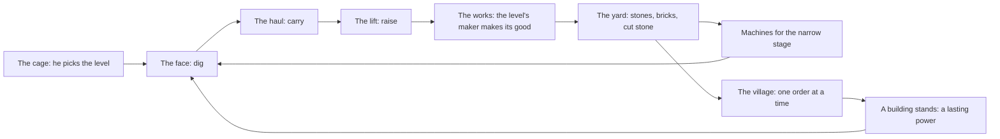

# The line, the works and the village: design (14 Nov 2026)

Status: approved by Flemming on 14 Nov 2026 (his answers are under [Decided](#decided-flemming-14-nov-2026)). Later the same day he approved an amendment, the cage ([The levels and the cage](#the-levels-and-the-cage)): he chooses which level the crew works, and each good comes from one level's rock. When this spec was written nothing in it was built. This spec covers many slivers in three steps. It ships as its own PR on a parent issue and is split into sliver issues (`.claude/rules/superpowers.md`). Every number in it is a starting value for the lab, not a tuned one.

## Why

On 14 Nov 2026 Flemming's first run ended while he slept. The Crown, the Deep Heart and the Mantle all landed in time away, and he woke to 2.36B stones with nothing to spend them on. He said it felt flat, unlike Factorio. The diagnosis (`ideas/2026-11-14-time-away-diagnosis.md` in the project's shared files, not in this repo) found the causes:

1. Every goal is a mark on stones mined, so time away plays the story for him.
2. Waiting and deciding do the same job: both only make the one number bigger.
3. Stones have one use, more stone speed, so surplus is dead.
4. Nothing ever starves, so there is nothing to diagnose.
5. He has built nothing he can look at.

He said yes to one combined design from three ideas: a bottleneck mine, stones that become goods, and village orders. He then added that the relics probably go away in the new design. He has since said yes to it ([Decided](#decided-flemming-14-nov-2026)), and this spec says what it costs.

## Where this is going: the rocket

Flemming, 14 Nov 2026: the long game is a progression that ends with building a rocket and sending people to Mars. On the way the mine digs more kinds of resource, gets more machines, and makes goods that are refined or manufactured. The last building of a run will move as the game is developed. In the end it is the rocket.

This spec is the first stretch of that road: three goods and six buildings. It is written so the road can go on without a rewrite. These are rules for the builder:

- **The buildings are a list.** Six is what this spec builds, not a limit. A run ends at the last building on the list, whichever it is. The Legend and the pass belong to "the last building", never to the Home by name.
- **Goods are rows in a table.** A row says where the good comes from, which pile holds it and what it buys. There are three rows now.
- **A maker has inputs and one output.** Kilns and saws take rock. A later maker can take goods, which is what refined and manufactured mean.
- **A stage holds a list of machines.** Two each now, more later.
- **A price is a short list of goods.** In this spec it is one good. Later, dearer things may ask for two or three, and for manufactured goods.
- **The bands are a list, and the mountain has no bottom.** Deeper bands with new rock can be added under the Deep Heart, each behind a door like step 3's.
- **A band he has reached stays open as a level.** He chooses which level the crew works, so he chooses the rock. A new band is one more level, and a level can get more than one maker. Nothing may assume the crew works the deepest band. With no bottom, the step 3 builder keeps every count in the save inside the safe-integer limit, as `MAX_STRETCH` does for kid runs today (#366).
- **A save keeps its place when the list grows.** A run that had built the old last building gets the next order. Nothing it built is taken back.

The seeds are already in the mountain. Clay, iron, crystal and heartstone are band materials today, a trickle for the bench. A later stretch can mine one in volume as a good of its own, by giving its level a maker. As a sketch only: iron for a hull, crystal for glass, heartstone for fuel. Nothing past the six buildings is designed here.

## The loop in one picture

The village asks. The works makes. The line feeds the works.

- **The cage** stops at the level he picks. That level's rock is what the line moves.
- **The line** is three stages: the face, the haul and the lift. It moves as fast as its slowest stage.
- **The works** is the fourth stage. It turns a level's rock into that level's good: the Topsoil's into bricks, the Granite's into cut stone.
- **The yard** holds the goods. When it is full the crew rests, so time away fills a yard he sized and then stops.
- **The village** asks for goods, one order at a time. A filled order raises a building, and a finished building gives the power a relic gives today. Only his tap delivers.

Three steps, each one playable and better than the game before it:

| Step                      | Adds                                                                         | Stays as it is                              |
| ------------------------- | ---------------------------------------------------------------------------- | ------------------------------------------- |
| 1. The line               | Three stages and the narrow one, then the cage                               | Stones are the money, the relics, time away |
| 2. The works and the yard | Bricks, cut stone, the cage as the lever, the yard as the limit of time away | The relics                                  |
| 3. The village            | Six buildings in the relics' place, orders as the goal                       | The line, the works, the yard               |

## Goals

- A check-in has a diagnosis: which stage holds the line now, and what is the cheapest way to widen it.
- The narrow stage keeps moving, from his buys and from the rock he chooses to dig.
- He chooses what the mine digs. No rock is gone for good because the shaft passed it.
- Time away fills the yard and stops. No building, band or order moves on without his tap.
- Surplus always has a use: the next machine, a bigger yard, or the village.
- He builds something he can look at: a village of six buildings.
- The two-minute check-in stays two minutes. The check-in guardrails from the economy overhaul stay strict (`docs/economy-overhaul.md`).

## Non-goals

- No map, no layout to draw, no belts. The line is three numbers and a mark on the lowest.
- No second order, no order choice, no market, no prices that move.
- No more than four stages and three goods in these three steps. Later stretches add more (the rocket, above).
- No new engine, no tileset world. The village is one picture with its buildings on it.
- No sliders and no crew rosters. The one new control is the cage.
- No second mine in these steps. Separate mines are kept for one place on the road: Mars, after the rocket.

## Anti-goals

- A chore before bed. If sizing the yard feels like homework, the step failed.
- A trap. A buy must not make the line slower, and a new player's first machine must show a gain. Step 1's staffing row says how that is held and tested.
- A second story fighting the first. The board has room for one spine.

---

## Step 1: the line

### The rule

1. Rock goes through three stages: **the face** (dig), **the haul** (carry to the shaft) and **the lift** (raise it).
2. Every machine belongs to one stage. A stage can move the sum of its running machines. A machine's own speed is worked out as today: its marks, gear, engineer, band rock and Legacy.
3. **Hands fill in.** Workers and kids do whatever job is short. A worker moves 1 stone a second through the whole line by hand, a third of his time on each job. Put on one job he does 3 a second of it. A worker who runs a machine still lends his hands, as today. The foreman sends the hands to the lowest stage until it is level with the next, then to both, and so on.
4. The line's speed is the level the hands reach. That is what the gauge reads, what is mined, and what time away pays 30% of.
5. A machine in a stage that already stands at or above that level adds nothing. Its Buys row says so before the tap.

So with no machines the game is today's: twelve workers dig 12 stones a second. The first cart (rated 18) lets the hands stop carrying and adds 6. A stage's first machine always adds something, because it frees the hands that did that job. With twelve workers and a cart, the first hoist adds 9, and the first drill after it adds 27. So a first buy never reads +0. The +0 row of rule 5 comes only for one more machine in a stage that already stands at or above the line. It can come early: with exactly twelve workers and one cart, a second cart reads +0 until he has a hoist or more hands. As machines take over, the hands matter less and the lowest stage rules. The bottleneck arrives by itself as the mine grows, with no moment where a rule switches on.

Exact form, for the builder: with machine capacities F, C, L and hand work U = 3 × (the hands' stones a second), the line's speed T is the largest T with max(0, T − F) + max(0, T − C) + max(0, T − L) ≤ U.

### Machines

Every stage gets two machines. The paper check below shows why: a stage with one machine becomes the narrow one and stays there.

| Stage | Machine         | Opens                                                         | First price | Rated a second | Workers         |
| ----- | --------------- | ------------------------------------------------------------- | ----------- | -------------- | --------------- |
| Haul  | Mine cart       | once he owns twelve workers, so it reads its full +6 a second | 600         | 18             | 1               |
| Lift  | Hoist (new)     | once he owns a cart                                           | 6,000       | 60             | 1               |
| Face  | Steam drill     | once he owns a hoist                                          | 73,080      | 108            | 1               |
| Face  | Tunnel borer    | the Granite                                                   | 4,940,000   | 1,071          | 8               |
| Haul  | Pit train (new) | the Crystal Caves                                             | 30,000,000  | 3,200          | 8               |
| Lift  | Great Machine   | the Deep Heart, with the Hammer                               | 120,600,000 | 6,300          | 10, or 5 tended |

Ratings are three times today's because of rule 3, so a first cart still shows +6 a second. The Great Machine becomes the great winding engine at the pithead, where its picture already stands in the mine window. Workers and kids are the hands. Prices, growth and ownership marks keep today's shape, and the new machines get marks like their neighbours.

### The rock moves the narrow stage too

Each band is tough on one stage's first machine and opens that stage's second machine.

| Band              | Tough on              | Opens and suits    | Band tag                                 |
| ----------------- | --------------------- | ------------------ | ---------------------------------------- |
| The Topsoil       | nothing               | cart, hoist, drill | The Topsoil                              |
| The Granite       | drills: hard rock     | Tunnel borer       | The Granite · Suits borers               |
| The Crystal Caves | carts: long galleries | Pit train          | The Crystal Caves · Suits trains         |
| The Deep Heart    | hoists: a deep shaft  | Great Machine      | The Deep Heart · Suits the Great Machine |

Suits is ×1.1, as today. Tough is ×0.8 today, and the paper model used ×0.7: the stronger the rock, the more it moves the narrow stage. At ×0.8 the model's check-in dad opened 8 sittings in a row on one stage. At ×0.7 it was 5. The lab (#543) sets the number.

Against today's table (decision D3, #246) the Granite does not change, and three cells do:

- The Crystal Caves suit pit trains, not drills, and are tough on carts, not borers.
- The Deep Heart is tough on hoists, not borers. It still suits the Great Machine.

So two lines of advice change: "The Crystal Caves suit trains. Tough on carts." and "The Deep Heart suits the Great Machine. Tough on hoists." Which machine a band favours is Flemming's call (D3). He said yes to this table on 14 Nov 2026, as part of the cage ([Decided](#decided-flemming-14-nov-2026)). The lab (#534, #543) uses it, and the switch-on (#536) shows it in the form #543 settles.

Until the cage is built the crew works the deepest band, so this table is what the rock does to him. With the cage it is what a level costs him when he chooses it ([The levels and the cage](#the-levels-and-the-cage)).

**One open form, for the lab.** A paper check of the cage ([Paper check](#paper-check)) found that rock which slows only a stage's first machine hardly moves the line, because the stage's second machine soon carries it. The other form slows the whole stage: the Granite the face, the Crystal Caves the haul, the Deep Heart the lift, at the same factor, with no ×1.1. This spec recommends the whole-stage form.

The form is settled where the line's numbers are tuned (#543), before the line turns on (#536). So the economy is switched on once: the cage never changes the rock's form, no save loads slower because of it, and no lab row moves when the cage is added. The table's form is what Flemming approved, so it stays unless he says otherwise. #543 reports `narrowRun` and the run's length for both forms. If every strict row and the generations lab pass with the whole-stage form and its `narrowRun` is at most one sitting longer, #543 stops and puts the rows to him as one question, with the band tags and advice lines that would change ("The Granite · Hard rock"). It tunes to his answer. If the whole-stage form does not pass, the table's form stays and the PR says why.

### What he sees

- **The three bays become the three stages.** Each shows what the stage can move a second and how much of that is spare. The lowest reads "Holds the line". A tap opens Buys at that stage's machines.
- **The lamp on the narrow stage is amber, not red.** There is always a lowest stage, so a red lamp would never go out, and red means trouble to fix (the one lamp rule, #509). Amber is "the board's pick", which is true: the Ready now plate picks from that stage.
- **Ready now** offers the biggest machine for the lowest stage that the free hands can run and the pocket covers. Its footnote says so. It never offers a buy that adds nothing: with too few hands for a machine to help, it offers a worker. It still never buys by itself.
- **Buys** groups its rows by stage. Every row's gain is the line's real gain. A row with no gain keeps its price, shows "+0/s" and a quiet "The lift has room to spare", with a dark lamp. It still buys, like a row short of workers today.
- **The crew line** says where the hands help: "Hands help at the haul".
- The mine window already shows the run from the face to the cage. A pile where the line is held is a later nicety, not part of this step.

### The approved mock (#535)

Flemming approved the mock of all this on 14 Nov 2026: the pictures in `mockups/line/shots/`. #537 and #538 build what they show. Where they say more than the list above, the mock rules. The pictures are the record, not the page that drew them (`/mockups/line/index.html?scene=mid` on the dev server): it is typechecked against today's `src` and reads today's markup, so the first sliver that breaks it deletes `index.html`, `line.ts`, `line.css`, `shots.mjs` and their two `knip.json` entries. `mockups/line/art/` and `mockups/line/shots/` stay.

- **A bay** keeps its lamp, its icon and its two lines of words. Five flaps read what the stage's machines move a second, in the gauge's own figures, with "/s" beside them. The count flaps and the Next price leave the bays: both are in Buys.
- **A bay's line** is "Holds the line" on the lowest stage (in the lamp's amber), "4,700/s spare" on a stage above the line, and "Hands add 9/s" on a stage the hands lift that is not the lowest.
- **A bay's icon** is the biggest machine he owns in that stage. While he owns none it is the stage's first machine, dim.
- **A bay's lamp** is amber on the lowest stage, green on a stage where a machine he can afford would add something, and dark where there is room to spare. One picture breaks this rule and the rule stands: after two trains (`mid-after.png`) the haul reads "Hands add 1,000/s" with a dark lamp, though a cart he can afford would still add a little. The builder lights it green.
- **Ready now's second line** names the stage: "+2,025/s · the haul holds the line".
- **Buys** goes Crew, The face, The haul, The lift. A stage's legend says "Holds the line" or "Room to spare" at its right. The crew line reads "10,100/s · Hands help at the haul", and the chips count the crew by stage: "38 at the face".
- **The line's How it works card** is the first card under Buys' "i", over Staffing. Two cards fill the drawer, so Layers and hardness moves to the Ledger's "i".

Two lines of words are not the mock's to rule:

- **A machine row's second line** is today's `nextMark` line from `src/milestones.ts`. The mock typed its rows by hand, and the Pit train's reads "0 of 5 · Every train hauls twice as fast." where the game says "0 of 5 · They haul twice as fast." The game's words stand.
- **The Buys footnote** is in no picture: the footnote hides while the list scrolls, and it scrolls in both Buys pictures. Its words for the line are not approved yet. A draft for #538 to put to Flemming: "Ready now offers the biggest machine for the stage that holds the line, if your free workers can run it and you can afford it. It never buys for you."

The mock leaves four things to the builder: what the bays read before the first cart, when every stage is by hand and level; which stage is the lowest on a tie; the legend in Buys of a stage the hands lift that is not the lowest, which is neither "Holds the line" nor "Room to spare" (no Buys picture shows one); and the trouble shout on a stage bay (#539).

### Where today's parts land in step 1

| Part                       | In step 1                                                                                                                                                                                                                                                                                                                                                                                                                                                                                                                                                                                                                                                                                  |
| -------------------------- | ------------------------------------------------------------------------------------------------------------------------------------------------------------------------------------------------------------------------------------------------------------------------------------------------------------------------------------------------------------------------------------------------------------------------------------------------------------------------------------------------------------------------------------------------------------------------------------------------------------------------------------------------------------------------------------------ |
| Stones, prices, the pocket | Unchanged. Stones are the money.                                                                                                                                                                                                                                                                                                                                                                                                                                                                                                                                                                                                                                                           |
| Relics and their powers    | Unchanged.                                                                                                                                                                                                                                                                                                                                                                                                                                                                                                                                                                                                                                                                                 |
| Time away                  | Unchanged: 30% of the line, today's caps.                                                                                                                                                                                                                                                                                                                                                                                                                                                                                                                                                                                                                                                  |
| Ownership marks            | Unchanged, per machine. A mark is now a jump in one stage, which is what moves the narrow place.                                                                                                                                                                                                                                                                                                                                                                                                                                                                                                                                                                                           |
| Staffing                   | The foreman staffs the machines that move the most rock through the whole line: #500's rule, with the line's speed as what it weighs. It need not find the exact best split. It must keep today's promise, tested on the saves `rates.test.ts` sweeps: one more hand or machine never slows the line, and any rare exception is listed in `docs/DESIGN.md`, as today. #532 leaves staffing as it is (a stage is the sum of what today's rule runs), so there the promise covers only the hands rule: for given stage speeds, more hands or a faster stage never slow the line. The staffing promise is owed from #534, which changes what it weighs, and so before the line is on in play. |
| Engineers                  | They tend a stage, not a machine type. The posts are the face, the haul, the lift, the Great Machine and camp. On a stage she gives her rank's tenths to every machine of that stage. The lift post speeds hoists only. The Great Machine post speeds it and halves its crew, as today. The borer's seven quarters and the tending floor stay per machine, unless the lab (#534, #543) shows a problem. Moving her to the narrow stage is the free, instant fix. Grandpa is unchanged: he tends the biggest running group no engineer tends, and hoists and trains count as groups.                                                                                                        |
| Trouble                    | A cave-in is at the haul, a flood at the face, a jam at the lift. It slows that stage, so it bites only where the line is tight. Still live only, still fixed by hand, or by the engineer who tends the troubled machine, as today: the lift post for a jam on hoists, the Great Machine post for a jam on it.                                                                                                                                                                                                                                                                                                                                                                             |
| Workshop gear              | Unchanged: rails on carts, bits on drills, the core on the Great Machine. Each widens its stage. Reinforce's next machine follows the price order: cart, hoist, drill, borer, pit train, Great Machine.                                                                                                                                                                                                                                                                                                                                                                                                                                                                                    |
| Synergies, upgrades        | Unchanged. The four synergy pairs stay as they are. The hoist and the pit train get none in this step.                                                                                                                                                                                                                                                                                                                                                                                                                                                                                                                                                                                     |
| Overtime, grease, a charge | Unchanged: they speed the whole line.                                                                                                                                                                                                                                                                                                                                                                                                                                                                                                                                                                                                                                                      |
| Veins and the Gold rush    | Unchanged: they read the line's speed.                                                                                                                                                                                                                                                                                                                                                                                                                                                                                                                                                                                                                                                     |
| Old saves                  | None. The save starts fresh (Flemming, 14 Nov 2026; `2026-11-14-fresh-save-content-rows-design.md`), so there is no grant and no welcome line for one.                                                                                                                                                                                                                                                                                                                                                                                                                                                                                                                                     |
| Kid runs                   | Unchanged.                                                                                                                                                                                                                                                                                                                                                                                                                                                                                                                                                                                                                                                                                 |

### The levels and the cage

Added on 14 Nov 2026 after Flemming's concern: with one shaft that digs down through fixed bands, the rock picks itself, and he has no say in which resource is mined. A band's material is gone for good once the shaft passes it (the Workshop says "No clay this deep"). The research and the eleven options that were weighed are in the project's shared files, not in this repo (`ideas/2026-11-14-resource-choice-research.md`, `designs/2026-11-14-working-levels-design.md`). A real mine is one shaft with many levels, and that is the answer taken here. It is built as the last slivers of step 1, after the line is on.

**The rule**

1. **Every band the shaft has reached is a level.** The levels are a list, like the bands. A level never closes while there is rock left to dig (rule 4 has the one exception, the bottom).
2. **The cage stops at one level.** That is where the crew works. He moves it with a tap. The move is free and instant, it is saved at once, and it holds while he is away.
3. **The line's rock is that level's rock.** Its tough and suits (or its slowed stage) apply to the machines, wherever the shaft's foot is. Its material is what comes up.
4. **The shaft goes deeper only at the lowest level**, called the heading in this spec. Stones dug at a level above it go to the pocket as today. They are not depth, so they find no relic and open no band.
   - While the mountain still has a bottom (steps 1 and 2), a shaft at the bottom ends the digging at every level, as a mined-out mountain does today. No level pays after it.
   - The pocket has always been smaller than the mountain, and `MAX_STRETCH` leans on that. Digging above the heading breaks it, so a level above the heading pays only while the pocket is under the size of the largest mountain today (the mountain at `MAX_STRETCH`, about 4.5e15 stones, worked out from that constant and not written as a second number). No real play comes near it. From step 2 the yard is the limit.
5. **The machines are one fleet.** A machine bought once works at every level. What is on sale, every "Opens at", and every price that scales with the band go by the depth of the shaft, as today, never by where the crew stands.

The crew is at the heading by default, and a crew at the heading follows the shaft into a new band. So a save that never touches the cage plays as it would without it. The cage appears when the shaft reaches the Granite, the first time there are two levels. The Topsoil evening is as simple as today.

**What each level is**

| Level             | Its rock leans on        | Material   | Its rock makes, from step 2                     |
| ----------------- | ------------------------ | ---------- | ----------------------------------------------- |
| The Topsoil       | nothing                  | clay       | bricks, in kilns                                |
| The Granite       | the face: hard rock      | iron       | cut stone, at saws                              |
| The Crystal Caves | the haul: long galleries | crystal    | nothing in these steps (a later stretch: glass) |
| The Deep Heart    | the lift: a deep shaft   | heartstone | nothing in these steps (a later stretch: fuel)  |

"Leans on" is the band table above, in whichever of its two forms #543 settles.

**What he sees**

- **The band tag on the bays becomes the cage plate.** It reads where the crew works, in the tag's words. A tap opens the level card.
- **The level card** is a board card with one row per level and real numbers: the line's speed there, the stage that holds the line there, and what comes up. The heading's row says the shaft goes deeper there. A tap on a row moves the crew and closes the card. When the list outgrows the card, it pages like a drawer's list.
- **The mine window shows the level he chose.** Each band has its own picture today, so this needs no new art.
- **The bays, Buys and Ready now read the level he is on**, as they read the band today. Every gain stays a real number for where the crew stands.
- **Depth, the guide bar and "Opens at" lines** keep reading the shaft, not the crew.
- **The arrival card** for a new band gets one line: the cage stops here now, and at every level above. The first time, a teach note points at the plate.
- **The welcome card** names the level when the crew spent the time away above the heading.

No new key, no new bay and no slider. Names, lines and the card's layout are Flemming's to approve from a mock.

**Where today's parts land with the cage**

| Part                       | With the cage                                                                                                                                                                                                                                                                                                                                                                                                                                                                                                                                                                                                                                                                                                                                                                              |
| -------------------------- | ------------------------------------------------------------------------------------------------------------------------------------------------------------------------------------------------------------------------------------------------------------------------------------------------------------------------------------------------------------------------------------------------------------------------------------------------------------------------------------------------------------------------------------------------------------------------------------------------------------------------------------------------------------------------------------------------------------------------------------------------------------------------------------------ |
| Depth and relics           | Move only at the heading. A night on an upper level finds no relic.                                                                                                                                                                                                                                                                                                                                                                                                                                                                                                                                                                                                                                                                                                                        |
| Materials                  | The working level's material comes up, one unit for the same number of stones dug as when that band was the heading. Above the heading a material stops when the pocket holds what its band gives in a whole run today (10 clay, 35 iron, 15 crystal, 12 heartstone, read from `materialsFromMined` and not kept as a second table), and refills up to that. At the heading it comes as today. So no material is gone for good. That number is a starting value: iron that refills can keep axle grease running, and the lab's new player type plays exactly that (below).                                                                                                                                                                                                                 |
| Time away                  | Pays 30% of the line's speed at the level he left the crew on. Depth moves only if that is the heading.                                                                                                                                                                                                                                                                                                                                                                                                                                                                                                                                                                                                                                                                                    |
| Taps, veins, the Gold rush | Unchanged. They read the line's speed where the crew works. A tap digs at the working level.                                                                                                                                                                                                                                                                                                                                                                                                                                                                                                                                                                                                                                                                                               |
| Trouble, engineers, gear   | Unchanged. They belong to machines and stages, not to a level.                                                                                                                                                                                                                                                                                                                                                                                                                                                                                                                                                                                                                                                                                                                             |
| Upgrades and promotions    | Priced by the band the shaft stands in, as today, so moving the crew up never makes anything cheaper.                                                                                                                                                                                                                                                                                                                                                                                                                                                                                                                                                                                                                                                                                      |
| Kid runs                   | The levels are the bands this run's shaft has reached. A new run starts with the Topsoil alone.                                                                                                                                                                                                                                                                                                                                                                                                                                                                                                                                                                                                                                                                                            |
| Old saves                  | None: the save starts fresh. The save says where the crew works: "the heading", or a named level above it. A named level the shaft has not reached reads as the heading. It also keeps the stones dug above the heading in this run (below), and what a material's count needs to carry a part-unit. A new fact is added to the save as the fresh-save spec says (`2026-11-14-fresh-save-content-rows-design.md`), not mirrored in `firestore.rules`.                                                                                                                                                                                                                                                                                                                                      |
| Which copy is ahead        | Today the later run wins, else more stones mined, else a newer `lastSeen`, and stones mined is depth. A night above the heading moves no depth, so a stale copy one stone deeper would beat it. The save therefore counts the stones dug above the heading in this run, a number that only grows and has the pocket's ceiling. "More stones mined" becomes the stones dug in the run: the depth turned into stones (`shownStones` does that today) plus that count. One helper gives the figure to both places that compare copies (`save-progress.ts` and `save-merge.ts`). `.claude/rules/observable-saves.md` and the conflict card's figures are updated with it. This is its own sliver, after the rule and before the cage is on in play. Step 3's closed doors need the same count. |
| The lab                    | Every player type of today stays at the heading, so their rows do not move when the cage is added. One new player type uses the cage: it works the level whose material its next craft lacks, else its fastest level, and it crafts whenever it can. So the lab plays the case the materials row worries about: a crew parked on the Granite for iron, with axle grease always running.                                                                                                                                                                                                                                                                                                                                                                                                    |
| The Workshop's rows        | A recipe row reads "No clay this deep" today, once the shaft has passed a material's band. With the cage the material is one move away, so the row says where it is instead ("Clay is at the Topsoil", his line to approve), and a tap on it can open the level card. With the shaft at the bottom no level pays, so the row reads as today.                                                                                                                                                                                                                                                                                                                                                                                                                                               |

In step 1 the choice is honest but small. Stones are the only good, so the cage is for the bench's materials and for a few percent of speed. It gets its weight in step 2, where each level's rock makes its own good.

### Why it stands alone

After step 1 every sitting has a question that a single sort cannot answer: the narrow stage, and whether to widen it with a machine, a mark three buys away, an engineer, a craft or more hands. With the cage he also decides which rock comes up. Nothing else has moved, so if the line is not fun we stop here and have lost little.

---

## Step 2: the works and the yard

### Goods

There are three goods. Stones stay, as the everyday good. The works adds two.

| Good      | Made by              | From               | Opens             | Buys                                                                                               |
| --------- | -------------------- | ------------------ | ----------------- | -------------------------------------------------------------------------------------------------- |
| Stones    | the line, by default | any level's rock   | the start         | workers, carts, hoists, drills, kilns, boosts, the Topsoil's upgrades, the stones part of a recipe |
| Bricks    | kilns                | the Topsoil's rock | the Granite       | borers, saws, yard levels, promotions, the Granite's upgrades                                      |
| Cut stone | saws                 | the Granite's rock | the Crystal Caves | pit trains, the Great Machine, kids, the deep upgrades                                             |

Two rules set every price. A thing costs the good of the band where it first opens: stones in the Topsoil, bricks in the Granite, cut stone from the Crystal Caves on down. A works machine costs the good below the one it makes: kilns cost stones, saws cost bricks. In these steps every thing costs one good, and different things cost different goods, as Flemming asked. Nothing changes its money mid-run.

### The cage is the lever

As first approved, the works had one lever with three positions (Stones, Bricks, Cut stone), and any rock made any good. Flemming changed that on 14 Nov 2026: **each good comes from one level's rock.** So the works needs no control of its own in these steps. The cage ([The levels and the cage](#the-levels-and-the-cage)) is the lever, and its positions are places.

- **A maker takes one level's rock.** Kilns take the Topsoil's rock and make bricks. Saws take the Granite's rock and make cut stone. A maker runs only while the crew works its level.
- **The rock goes to the level's maker, as fast as the maker can take it.** What it cannot take is stacked as stones. So a rock is never wasted, the works never slows the dig, and the cage decides the mix. One rock makes one brick or one cut stone.
- **A level with no maker gives stones.** In these steps that is the Crystal Caves and the Deep Heart, and any level before its maker is on sale. So the heading always gives stones, and the way down.
- **A maker opens one band after its rock**, as in the table above: kilns when the shaft reaches the Granite, saws at the Crystal Caves. The Granite's arrival teaches the whole idea at once: the yard opens, the kilns go on sale, and the cage can go back up for bricks.
- **Going deeper and making goods compete for the crew.** That is real mining: sinking earns stones, and the levels above earn the goods.

The lever comes back only when one level has two makers (say the Granite: cut stone or iron bars). Then it picks among that level's makers, and "stack it all as stones" is one of its positions. A flat lever would not have survived twelve goods.

Kilns and saws are bought like machines and have ownership marks. They take no workers, no engineer, no gear and no trouble, and the band's rock does not touch them. That keeps the foreman's job to the line, where "the most rock" has one meaning. Everything runs at the resting pace while he is away, the works too.

For a level's good the works is a true fourth stage: bricks a second = the lower of the line at the Topsoil and the kilns. The board says which one holds the bricks.

### The yard

From the Granite on, goods sit in the yard: one pile for each good. One yard level sets the room of all three piles, and "Extend the yard" (bricks) raises it.

- A full pile takes no more. Rock for it is stacked as stones. When the stone pile is full too, that flow stops. When nothing can flow, **the crew rests**. Depth stops with it.
- Taps and golden veins always land. They are his own hands.
- A price above a pile's room reads "Needs a bigger yard", the same kind of line as "Needs 8 workers". The next yard level never costs more than the brick pile holds.
- Nothing can lock: stones come at every level, kilns cost stones, saws cost bricks, an opened level stays open, and a full pile is always spendable.

### Time away

From the Granite on, time away runs at the resting pace **until the yard is full**, and the clock cap goes. Before the Granite the Topsoil keeps today's rule, so the first evening is as simple as now. The welcome card says what came in and what stopped it: "The stone pile filled at 02:04, the cut stone at 04:17."

This is the heart of the fix. The limit of a night is his own yard and where he left the cage. Goods left in the piles at bedtime take room from the night, so the evening sitting has a point: spend, and from step 3 deliver.

### Where today's parts land in step 2

| Part                       | In step 2                                                                                                                                                                                                                                                                                                                                                                                                                                                                                                   |
| -------------------------- | ----------------------------------------------------------------------------------------------------------------------------------------------------------------------------------------------------------------------------------------------------------------------------------------------------------------------------------------------------------------------------------------------------------------------------------------------------------------------------------------------------------- |
| The Shield                 | Its power changes, since the clock cap is gone: "The yard holds twice as much." In this step it is found at the very depth where the yard opens, so it has no before. Step 3's Storehouse does.                                                                                                                                                                                                                                                                                                             |
| The Heart                  | Its power changes too: a faster resting pace only fills the yard sooner. New power, in the same spirit: **a rested crew**. After he has been away 8 hours or more, the line runs ×1.5 for his first ten minutes back. It is a live crew timer like Overtime (the strongest one counts), so a long night feeds the check-in and stocks nothing extra.                                                                                                                                                        |
| Steady hands               | Unchanged: a faster resting pace. It helps the gaps between check-ins and adds nothing to a night that fills the yard. The lab may re-aim it.                                                                                                                                                                                                                                                                                                                                                               |
| The other relics           | Unchanged.                                                                                                                                                                                                                                                                                                                                                                                                                                                                                                  |
| The odometer               | Shows a pile and its room. All three piles must be readable on the board without a drawer. A mock settles how.                                                                                                                                                                                                                                                                                                                                                                                              |
| Materials and the Workshop | Clay, iron, crystal and heartstone stay a trickle for the bench, from the level the crew works (step 1's cage). The lab looks again at the recipes, which were sized for a band that ends.                                                                                                                                                                                                                                                                                                                  |
| The Gold rush              | The held part comes from the night's stones, as today, and lands even on a full pile.                                                                                                                                                                                                                                                                                                                                                                                                                       |
| Old saves                  | The pocket becomes the stone pile. A pile over its room keeps what it has and takes no more. The save is granted kilns (from the Granite) and saws (from the Crystal Caves) that can take a third of its line, so the cage matters on its first day. Prices in bricks and cut stone start from that day. When this step is split, the builder asks whether Flemming is still the only player: if he is, a fresh start may take this grant's place (`2026-11-14-fresh-save-content-rows-design.md`, Resets). |

### Why it stands alone

After step 2 a night away ends at a full yard, not at a finished mountain. Surplus stones turn into bricks and cut stone, and the big machines need them. Where the cage stops is one real choice in every sitting, and it moves the narrow stage with it. The village is not needed for any of that.

---

## Step 3: the village

### Six buildings in the relics' place

The relics go. Their six virtues, their order and their powers move to six buildings that he builds.

| Was                   | Virtue          | Becomes        | Power                                                                                | Asks for          |
| --------------------- | --------------- | -------------- | ------------------------------------------------------------------------------------ | ----------------- |
| Lantern of Guidance   | Guide           | The Beacon     | Golden veins come 40% sooner                                                         | stones            |
| Shield of Protection  | Protect         | The Storehouse | The yard holds twice as much                                                         | stones, bricks    |
| Hammer of the Builder | Build           | The Forge      | The Great Machine can be built                                                       | bricks            |
| Heart of Patience     | Patience        | The Mill       | A rested crew: after 8 hours away, the line runs ×1.5 for his first ten minutes back | bricks, cut stone |
| Crown of Wisdom       | Teach           | The School     | Kid workers                                                                          | cut stone, bricks |
| Mantle of the Hero    | Become the hero | The Home       | He is a Legend, and can pass the mine to his kid                                     | all three         |

The names are suggestions. Names, lines and pictures are Flemming's to approve when they are built.

The Home's power is the last building's power. When a later building takes the last place, the Legend and the pass move to it, and the Home gets a power of its own.

### Orders

- **One order at a time.** A building rises in three orders: footings, walls, roof. Each asks for real amounts: "The School, walls: 30M bricks, 20M cut stone."
- **An order names its levels.** Each good comes from one level, so an order for two goods is a plan for two nights, and the split is his.
- **He delivers.** Each good has its own Send, which sends what the pile holds, up to what the order still needs. Part deliveries count. To keep bricks for a borer, he buys the borer first.
- **A roof is the reveal.** The building's last order gives its power, in the moment the relic reveal has today.
- **What comes next stays vague.** The next building is a hint in the village's words, never a list.
- The order's goods and bar show on the board. The six sockets at the top hold the six buildings, with the tag "The village · 2 of 6". When the list grows past six, the plate shows the six around the open order and the drawer shows them all.
- The relics drawer becomes the village drawer: one picture of the village, each building in its state, and the order under it.

### Buildings open the bands

Once the story is in the village, nothing ties it to depth, and a dad could reach the Deep Heart with no Forge and so no Great Machine. So each band has a door, new in step 3, that opens with a building. At a closed door only depth waits: the line keeps making goods, and the heading still gives stones. Between doors, sinking the shaft through a band takes the crew away from the goods. The lab sets how long a band takes to sink. It should be a night or two, because the story is in the village.

| Door              | Opens when        | Why it can never lock                                                                                                               |
| ----------------- | ----------------- | ----------------------------------------------------------------------------------------------------------------------------------- |
| The Granite       | the Beacon stands | The Beacon asks for stones only                                                                                                     |
| The Crystal Caves | the Forge stands  | The Storehouse and the Forge ask for stones and bricks. Kilns are on sale from the Granite, and bricks are made at the Topsoil      |
| The Deep Heart    | the School stands | The Mill and the School ask for bricks and cut stone. Saws are on sale from the Crystal Caves, and cut stone is made at the Granite |

The Home's roof also asks for a few heartstone, the Deep Heart's own material, for its hearth. He gets it by sending the crew to the Deep Heart. So a run cannot end without the last band, and heartstone gets a meaning. A later last building brings a tie of its own.

### Old saves at step 3

When this step is split, the builder asks whether Flemming is still the only player: if he is, a fresh start may take the place of what follows (`2026-11-14-fresh-save-content-rows-design.md`, Resets).

A save keeps what it earned. Each relic it had found becomes that relic's building, standing, with its power. The open order is the footings of the next one. A save that was already a Legend has the Home, and the pass is offered as today.

### The end of a run

A run ends when the last building's roof is on, not at the bottom. In this spec that is the Home. So the mountain gets no bottom: the Deep Heart goes on down, and "stones left" leaves the Ledger. Depth is a place, not a goal. The bands still open in order, each at its door.

Passing the mine: the kid inherits the village. The buildings stand as he left them, and a brass number on each counts the generations that raised it. There is no new picture for a generation. The kid's orders raise each one again, in bigger amounts, and each power comes back with its roof. So the lab's rule holds as it does for relics today, which also start again. The kid-run stretch scales the band depths, the prices and the order amounts together. What is in the yard at the pass goes into the kid's first order, so the last night's goods are never dead.

### What removing the relics costs

- **The premise and the name.** "The Legendary Relics of Fatherhood", left by the great dads of history, goes. The vision line and the title need new words.
- **Wonder.** A relic is found. A building is earned. The vague tease of something old in the dark is the one thing this design makes weaker. What is left of it: bands unknown until reached, expedition finds, and the hint of the next building.
- **Work already done.** The relic plate, the shelf, the reveal built last week (#523), the relic pictures, the Ledger's relic rows and its guide bar, and the relics card. The sockets, the drawer, the reveal's staging and the powers' code are reused. The pictures are not.
- **Keepsakes** move from a relic's page to the last building (the Home, in this spec). Expedition glimmers become word from the village.

What is kept: six virtues in the same order, six powers nearly word for word, six sockets on the board, a reveal for each, and the Legend at the end. What it gains: the story stops being a count the crew passes while he sleeps.

### Why it stands alone

Step 3 is the step that changes the goal. It needs steps 1 and 2 under it, but nothing after it.

---

## Paper check

A rough model, not the game's lab: `designs/line-model.py` in the project's shared files, not in this repo. It plays step 1's rule with the table's numbers, a dad who spends on the best gain per stone, and today's away pay. It answers one question: does the narrow stage keep moving?

| Dad                 | Run 1 ends | Sittings | Longest run of sittings that open on one narrow stage | Sittings opened on face / haul / lift |
| ------------------- | ---------- | -------- | ----------------------------------------------------- | ------------------------------------- |
| Check-in, 4 × 2 min | day 4.3    | 18       | 5                                                     | 4 / 10 / 4                            |
| Casual, 2 × 10 min  | day 4.5    | 10       | 3                                                     | 3 / 6 / 1                             |
| Evening, 1 × 20 min | day 6.0    | 7        | 2                                                     | 2 / 4 / 1                             |

- Run length lands near today's (3.7 to 5.0 days) with no tuning.
- In 56% of the casual dad's buys, machines in two or more stages were worth buying. In 29% the best buy was not in the lowest stage. So it is not "buy the marked one".
- **With one machine in the lift** (the Great Machine left outside the stages), the check-in dad opened his last 9 sittings in a row on the lift. That is why every stage has two.

### One sitting in step 1 (the model's casual dad, day 1.5, the Crystal Caves)

He opens on face 14.8K, haul 5.7K, lift 10.6K. The hands lift the haul, and the line moves 10.1K a second. The haul bay is amber.

1. Two pit trains (30M, 34.5M). Haul 12.8K. Now the lift is lowest. Line 13.8K.
2. Six hoists (2.8M to 6.5M). The sixth is his fiftieth, and the mark doubles them all. Lift 24.0K. The haul is lowest again. Line 16.0K.
3. A borer and three drills, with the workers they need. Face 17.6K. The haul is still lowest, and the hands lift it. Line 17.5K.

One sitting, 10.1K to 17.5K, and the narrow stage went haul, lift, haul. Three different machines were the right buy, and one of them was right because of a mark.

### One night in the finished design (worked by hand)

Evening. The shaft stands in the Crystal Caves. At the Granite level the line moves 18K a second, 5,400 at the resting pace. The saws take 2,400, or 720 resting. The yard holds 80M stones, 40M bricks and 15M cut stone. The order is the School's walls: 30M bricks (sent) and 20M cut stone (6M sent).

- 22:30. He sends the 4M cut stone in the pile. He spends stones down to 20M. He sends the cage to the Granite, for cut stone. He leaves.
- Cut stone comes at 720 a second. The other 4,680 a second is stacked as stones.
- 02:04. The stone pile is full. Only the 720 a second for the saws still moves.
- 04:17. The cut stone pile is full. The crew rests.
- 06:30. The card: "+60M stones, +15M cut stone. The stone pile filled at 02:04, the cut stone at 04:17."
- He sends 10M cut stone. The walls go up. The roof asks for 45M cut stone and 20M bricks.
- The saws are now the narrow place for what the village wants, and saws cost bricks. He buys two saws, spends the stones on the line, and leaves the cage at the Granite. The roof's bricks are a night at the Topsoil, and when to take it is his call.

What it shows: the night stopped at his yard, the card says when and why, the building needed his tap, and the new order moved the narrow place from the haul to the saws. Where the crew dug was his choice, not the rock's. Two minutes.

### The cage on paper

A second rough model, `designs/levels-model.py` in the project's shared files, adds a working level to the step 1 model. Stones are the only good in it.

| Rock                                                  | Sitting ends where the levels have different narrow stages (check-in / casual / evening) | Fastest level against slowest | Run 1 ends          |
| ----------------------------------------------------- | ---------------------------------------------------------------------------------------- | ----------------------------- | ------------------- |
| Slows a stage's first machine ×0.7 (the table's form) | 5 of 15 / 2 of 8 / 1 of 5                                                                | 5% on average, 11% at most    | day 4.3 / 4.5 / 6.0 |
| Slows the whole stage ×0.7                            | 12 of 16 / 6 of 9 / 3 of 5                                                               | 13% on average, 23% at most   | day 4.5 / 5.0 / 6.0 |

- **Parking is not an exploit.** A dad who always leaves the crew on the fastest level ends run 1 on the same day or half a day later than one who always digs the heading (day 4.5 against 4.3, 5.0 against 4.5, 6.0 against 6.0).
- **With the table's form, where he works hardly moves the line.** The second machine soon carries the stage. If choosing a level should also choose tonight's narrow stage, the rock has to slow the whole stage. That is why the lab reports both forms.

### What the check does not prove

Nothing about step 2 with the cage: goods by level have no model. Step 2's lab probe has to grade it before anything is switched on.

It does not prove the line is fun. It shows the structure moves. Hands may be too strong in the model: kids alone carried the haul for a while. If hands carry too much, the stages stop mattering. If too little, the early game gets traps. The lab has to grade that, and step 1 is built first so Flemming can feel it.

## Against the dad-friendly rules

| Rule                       | How the design meets it                                                                               |
| -------------------------- | ----------------------------------------------------------------------------------------------------- |
| Two minutes                | A check-in is: read the card, Send, Ready now or Max on the narrow stage, the cage.                   |
| Never punishing            | A full yard loses nothing earned. No buy slows the line. A level stays open. Trouble stays live only. |
| Close is pause             | The cage, a delivery and a buy are saved as they happen. Fill times are worked out from timestamps.   |
| Real numbers for decisions | Stage speeds, spare, each level's speed, pile room, order amounts and prices are all real.            |
| Vague discoveries          | The next band and the next building stay hints.                                                       |
| No payback, no best buy    | The amber mark is a reading of three numbers. Which fix to buy stays his.                             |
| The phone never scrolls    | Step 1 reuses the three bays and the band tag. Step 3 reuses the six sockets and the relics drawer.   |
| No placeholders            | Each step lists its art below. PixelLab is asked for before any of it.                                |

## Risks

1. **Size.** Step 1 retunes the whole economy: every lab guardrail is measured again. This is a new middle of the game, not a feature.
2. **Hands.** Too strong or too weak breaks step 1 in opposite ways (above).
3. **The yard as homework.** If a night's yard needs minding every evening, it fails the anti-goal. The first tune: with the piles emptied in the evening, an eight-hour night fits.
4. **Three goods on one board.** The odometer shows one number today. Step 2 needs a mock before any code.
5. **Wonder.** Step 3 trades found for earned.
6. **Speed of the lab.** `effectiveRates` is the labs' hot path, and the line's rule and the staffing search sit inside it.
7. **Moving the cage every sitting.** If that becomes the best play, the cage is a chore. Orders ask for a night's worth of a good, and the yard ends a night anyway. The lab counts moves a sitting.
8. **One resource at a time.** It may feel thin once there are five goods or more. Held in reserve, and not designed here: a night timetable, an ordered list of levels where the crew moves on when a pile is full.
9. **Materials that come back.** Recipes were sized for a band that ends. Above the heading a material stops at what its band gives in a run, and the lab's new player type plays the worst case.
10. **Step 2 is changed without a model.** The cage as the lever is right on paper only.

## Calls I made

These are mine, not Flemming's. Any of them can be turned over.

1. Hands fill in, so the bottleneck is soft early and hard late, rather than a hard minimum from the first cart.
2. Two machines in every stage. The Great Machine becomes the lift's second machine.
3. The band table: the Crystal Caves suit trains and are tough on carts, and the Deep Heart is tough on hoists. This one changed decision D3, which is Flemming's. He said yes to it with the cage.
4. The narrow stage's lamp is amber, not red.
5. Engineers tend a stage. Trouble belongs to a stage.
6. What the works cannot take becomes stones. (The lever with three positions that stood here is gone: the cage is the lever, by Flemming's choice.)
7. One yard level sets three piles. The yard starts at the Granite, and the clock cap ends there.
8. In these steps each thing costs one good, by the two price rules.
9. Taps and veins always land.
10. Six buildings in the relics' order with the relics' powers, three orders each. The list stays open.
11. The relics stay through steps 1 and 2, so no step leaves a hole where the story was.
12. The kid inherits the village, and a brass number counts the generations.
13. The cart is shown at twelve workers, so it reads its full +6. Ready now never offers a buy that adds nothing.
14. Kilns and saws take no workers, engineers, gear or trouble.
15. The Heart, and the Mill after it, give a rested crew: ×1.5 for ten minutes after 8 hours away.
16. Each band's door opens with a building, and the Home asks for heartstone.
17. At step 1 the save starts fresh, so there is no old-save grant (Flemming, 14 Nov 2026). At step 3, old saves keep a building for every relic they found, unless that step starts fresh too.
18. The Shield's power, and the Storehouse's after it: the yard holds twice as much.
19. What is in the yard at the pass goes into the kid's first order.
20. The Lantern's guide half (the next relic and the bar toward it) goes at step 3. The open order on the board takes its place.
21. One crew and one working level at a time. No split and no shares.
22. Moving the cage is free and instant.
23. The shaft goes deeper only at the heading.
24. One fleet of machines. What is on sale and what a band-scaled price costs go by the shaft, not by the crew.
25. The cage appears at the Granite, and the band tag is its control.
26. The cage is built as the last slivers of step 1, though its weight comes in step 2.
27. Above the heading a material refills up to what its band gives in a whole run.
28. The rock should slow a whole stage. The lab reports both forms before the line turns on, and the change from the approved table is put to Flemming with the rows.
29. A maker opens one band after its rock, and runs only while the crew works its level.
30. Seams found by engineers, the night timetable and a "wanted" mark on an order are named in the proposal and not designed.
31. With a bottom still in the mountain, a shaft at the bottom ends the digging at every level. Above the heading the pocket and a material's count each have a ceiling.
32. The save counts the stones dug above the heading, and the rule for which copy is ahead adds them.

## Decided (Flemming, 14 Nov 2026)

1. **The relics become village buildings.** Yes. Six is not a limit: more buildings come later.
2. **A run ends at the last building, and the mountain has no bottom.** Yes. Which building is last moves as the game is developed. In the end it is the rocket to Mars.
3. **Two new machines, the hoist and the pit train.** Yes, and probably more in the long run.
4. **Stones stay as the everyday good.** Yes. Different buildings and machines should cost different resources, with refined or manufactured ones late in the game.

He also stopped the relic-door work, so this spec does not lean on it. The band doors of step 3 are their own part of this design.

Later the same day, on the band table question, he said the design left the player no control over which resource is mined, and floated different mines. He was shown three ways (the cage, separate mines, old workings that keep producing) and said yes to both recommendations:

5. **One mountain, and the cage.** Every band the shaft has reached stays open as a level, and he sends the crew to the level he wants. This also settles the band table: [the table above](#the-rock-moves-the-narrow-stage-too) stands, as what each level costs him. Separate mines are kept for Mars.
6. **Each good comes from one level's rock.** Bricks from the Topsoil, cut stone from the Granite. The three-way lever becomes the cage.

## Waiting on Flemming

Nothing now. The band table that waited here is settled (Decided, 5). One question is planned: if the rock's whole-stage form passes in the lab, #543 asks him whether to take it ([the rock's two forms](#the-rock-moves-the-narrow-stage-too)). Names, lines, pictures and lab bounds are his at build time, as each section says.

## How it would be built

Each line is about one sitting. Each step's economy is probed in the lab behind a factor before it is turned on in play, as the generations work was.

**Step 1** is split into issues under #530:

1. #532: the line's rule in one module, off in play.
2. #533: the hoist and the pit train in the save.
3. #534: the lab plays the line. #543, split from it, sets the line's numbers and reports both forms of the rock.
4. #535: a mock of the stage bays and Buys by stage, with the hoist and pit train art. It can run beside 1 to 3.
5. #536: the line turns on in play. It waits for the fresh save and the reshape of #551 (`2026-11-14-fresh-save-content-rows-design.md`), and has no old-save grant.
6. #537: the three bays become the three stages.
7. #538: Buys by stage, and where the hands help.
8. #539: engineers and trouble by stage.

Then the cage, as the last slivers of step 1 (issues under #530):

9. #545: the working level in the rules and the save, with no screen yet: the rock by level, depth only at the heading, materials by level, the count of stones dug above the heading, and the new player type in the lab. It does not change the rock's form.
10. #546: a mock of the cage plate and the level card. It can run beside 9.
11. #548: which copy of a save is ahead counts the stones dug above the heading, with `observable-saves.md` and the conflict card's figures. After 9.
12. #547: the cage on the board, turned on in play: the plate, the card, the window, the arrival and welcome lines, the Workshop's row and the How it works card. After 9, 10 and 11.

Steps 2 and 3 are split when the step before has been played.

**Step 2.** A lab probe of the works and the yard, with the cage as the lever. A mock of the piles. Kilns and bricks. Saws and cut stone. The yard and the new rule for time away, with the welcome card. Prices by good and the old-save grant.

**Step 3.** A mock of the village plate and drawer, with the art. Orders and Send. The six buildings' powers in place of the relics'. The village drawer and the reveal. The run's end at the Home and the mountain with no bottom. The kid's village. Taking the relics out.

The rules for stages, levels and the yard go in one new module that `effectiveRates` reads (the line's module from #532), so live play, time away, the screens and the lab keep one home for every speed. Each new fact in the save is added as the fresh-save spec says (`2026-11-14-fresh-save-content-rows-design.md`): the rules check the envelope, and the parser checks the game.

## Lab

New measures, report-only first. Any bound on them is Flemming's to set.

- `narrowRun`: the longest run of sittings that open on the same narrow stage.
- `narrowShare`: the largest share of a run one stage spends as the narrow one.
- `handsCarry`: the share of the narrow stage that hands carry.
- `zeroGainBuys`: buys that added nothing to the line.
- From step 2: `yardRest`, the share of time away the crew spends resting on a full yard.
- With the cage: `levelShare`, the share of a run the crew spends on each level, and `levelMoves`, the moves of the cage a sitting. One new player type works the level whose material its next craft lacks, else its fastest level, and crafts whenever it can. Today's player types stay at the heading.
- From #543: `narrowRun` and the run's length for both forms of the rock (a stage's first machine, or the whole stage).

No existing bound moves to go green. The check-in guardrails, the generations lab and extreme win are measured again in every step.

## Art (PixelLab, asked for before each step)

- Step 1: the hoist and the pit train, each as a bay icon, a dim icon and a Buys icon, and any stage icons the mock (#535) calls for.
- The cage: none expected. The four window pictures exist, and the plate reuses the band tag. The mock says if a small mark for the plate is needed.
- Step 2: the kiln and the saw, icons for bricks and cut stone, the piles.
- Step 3: the village picture, six buildings in three states each, and one brass number plate.
