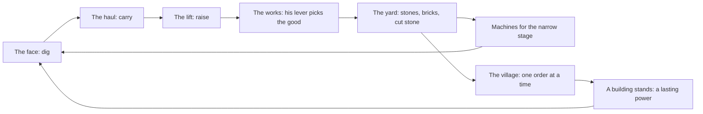

# The line, the works and the village: design (14 Nov 2026)

Status: approved by Flemming on 14 Nov 2026 (his four answers are under [Decided](#decided-flemming-14-nov-2026)). Nothing here is built. This spec covers many slivers in three steps. It ships as its own PR on a parent issue and is split into sliver issues (`.claude/rules/superpowers.md`). Every number in it is a starting value for the lab, not a tuned one.

## Why

On 14 Nov 2026 Flemming's first run ended while he slept. The Crown, the Deep Heart and the Mantle all landed in time away, and he woke to 2.36B stones with nothing to spend them on. He said it felt flat, unlike Factorio. The diagnosis (`ideas/2026-11-14-time-away-diagnosis.md` in the project's shared files, not in this repo) found the causes:

1. Every goal is a mark on stones mined, so time away plays the story for him.
2. Waiting and deciding do the same job: both only make the one number bigger.
3. Stones have one use, more stone speed, so surplus is dead.
4. Nothing ever starves, so there is nothing to diagnose.
5. He has built nothing he can look at.

He said yes to one combined design from three ideas: a bottleneck mine, stones that become goods, and village orders. He then added that the relics probably go away in the new design. He has since said yes to it ([Decided](#decided-flemming-14-nov-2026)), and this spec says what it costs.

## Where this is going: the rocket

Flemming, 14 Nov 2026: the long game is a progression that ends with building a rocket and sending people to Mars. On the way the mine digs more kinds of resource, gets more machines, and makes goods that are refined or manufactured. The last building of a run will move as the game is developed. In the end it is the rocket.

This spec is the first stretch of that road: three goods and six buildings. It is written so the road can go on without a rewrite. These are rules for the builder:

- **The buildings are a list.** Six is what this spec builds, not a limit. A run ends at the last building on the list, whichever it is. The Legend and the pass belong to "the last building", never to the Home by name.
- **Goods are rows in a table.** A row says where the good comes from, which pile holds it and what it buys. There are three rows now.
- **A maker has inputs and one output.** Kilns and saws take rock. A later maker can take goods, which is what refined and manufactured mean.
- **A stage holds a list of machines.** Two each now, more later.
- **A price is a short list of goods.** In this spec it is one good. Later, dearer things may ask for two or three, and for manufactured goods.
- **The bands are a list, and the mountain has no bottom.** Deeper bands with new rock can be added under the Deep Heart, each behind a door like step 3's. With no bottom, the step 3 builder keeps every count in the save inside the safe-integer limit, as `MAX_STRETCH` does for kid runs today (#366).
- **A save keeps its place when the list grows.** A run that had built the old last building gets the next order. Nothing it built is taken back.

The seeds are already in the mountain. Clay, iron, crystal and heartstone are band materials today, a trickle for the bench. A later stretch can mine one in volume as a good of its own. As a sketch only: iron for a hull, crystal for glass, heartstone for fuel. Nothing past the six buildings is designed here.

## The loop in one picture

The village asks. The works makes. The line feeds the works.

- **The line** is three stages: the face, the haul and the lift. It moves as fast as its slowest stage.
- **The works** is the fourth stage. It turns the line's rock into bricks and cut stone. One lever says which.
- **The yard** holds the goods. When it is full the crew rests, so time away fills a yard he sized and then stops.
- **The village** asks for goods, one order at a time. A filled order raises a building, and a finished building gives the power a relic gives today. Only his tap delivers.

Three steps, each one playable and better than the game before it:

| Step                      | Adds                                                             | Stays as it is                              |
| ------------------------- | ---------------------------------------------------------------- | ------------------------------------------- |
| 1. The line               | Three stages and the narrow one                                  | Stones are the money, the relics, time away |
| 2. The works and the yard | Bricks, cut stone, the lever, the yard as the limit of time away | The relics                                  |
| 3. The village            | Six buildings in the relics' place, orders as the goal           | The line, the works, the yard               |

## Goals

- A check-in has a diagnosis: which stage holds the line now, and what is the cheapest way to widen it.
- The narrow stage keeps moving, from his buys and from the rock he digs into.
- Time away fills the yard and stops. No building, band or order moves on without his tap.
- Surplus always has a use: the next machine, a bigger yard, or the village.
- He builds something he can look at: a village of six buildings.
- The two-minute check-in stays two minutes. The check-in guardrails from the economy overhaul stay strict (`docs/economy-overhaul.md`).

## Non-goals

- No map, no layout to draw, no belts. The line is three numbers and a mark on the lowest.
- No second order, no order choice, no market, no prices that move.
- No more than four stages and three goods in these three steps. Later stretches add more (the rocket, above).
- No new engine, no tileset world. The village is one picture with its buildings on it.
- No sliders and no crew rosters. The one new control is the lever.

## Anti-goals

- A chore before bed. If sizing the yard feels like homework, the step failed.
- A trap. A buy must not make the line slower, and a new player's first machine must show a gain. Step 1's staffing row says how that is held and tested.
- A second story fighting the first. The board has room for one spine.

---

## Step 1: the line

### The rule

1. Rock goes through three stages: **the face** (dig), **the haul** (carry to the shaft) and **the lift** (raise it).
2. Every machine belongs to one stage. A stage can move the sum of its running machines. A machine's own speed is worked out as today: its marks, gear, engineer, band rock and Legacy.
3. **Hands fill in.** Workers and kids do whatever job is short. A worker moves 1 stone a second through the whole line by hand, a third of his time on each job. Put on one job he does 3 a second of it. A worker who runs a machine still lends his hands, as today. The foreman sends the hands to the lowest stage until it is level with the next, then to both, and so on.
4. The line's speed is the level the hands reach. That is what the gauge reads, what is mined, and what time away pays 30% of.
5. A machine in a stage that already stands at or above that level adds nothing. Its Buys row says so before the tap.

So with no machines the game is today's: twelve workers dig 12 stones a second. The first cart (rated 18) lets the hands stop carrying and adds 6. A stage's first machine always adds something, because it frees the hands that did that job. With twelve workers and a cart, the first hoist adds 9, and the first drill after it adds 27. So a first buy never reads +0. The +0 row of rule 5 comes only for one more machine in a stage that already stands at or above the line. It can come early: with exactly twelve workers and one cart, a second cart reads +0 until he has a hoist or more hands. As machines take over, the hands matter less and the lowest stage rules. The bottleneck arrives by itself as the mine grows, with no moment where a rule switches on.

Exact form, for the builder: with machine capacities F, C, L and hand work U = 3 × (the hands' stones a second), the line's speed T is the largest T with max(0, T − F) + max(0, T − C) + max(0, T − L) ≤ U.

### Machines

Every stage gets two machines. The paper check below shows why: a stage with one machine becomes the narrow one and stays there.

| Stage | Machine         | Opens                                                         | First price | Rated a second | Workers         |
| ----- | --------------- | ------------------------------------------------------------- | ----------- | -------------- | --------------- |
| Haul  | Mine cart       | once he owns twelve workers, so it reads its full +6 a second | 600         | 18             | 1               |
| Lift  | Hoist (new)     | once he owns a cart                                           | 6,000       | 60             | 1               |
| Face  | Steam drill     | once he owns a hoist                                          | 73,080      | 108            | 1               |
| Face  | Tunnel borer    | the Granite                                                   | 4,940,000   | 1,071          | 8               |
| Haul  | Pit train (new) | the Crystal Caves                                             | 30,000,000  | 3,200          | 8               |
| Lift  | Great Machine   | the Deep Heart, with the Hammer                               | 120,600,000 | 6,300          | 10, or 5 tended |

Ratings are three times today's because of rule 3, so a first cart still shows +6 a second. The Great Machine becomes the great winding engine at the pithead, where its picture already stands in the mine window. Workers and kids are the hands. Prices, growth and ownership marks keep today's shape, and the new machines get marks like their neighbours.

### The rock moves the narrow stage too

Each band is tough on one stage's first machine and opens that stage's second machine.

| Band              | Tough on              | Opens and suits    | Band tag                                 |
| ----------------- | --------------------- | ------------------ | ---------------------------------------- |
| The Topsoil       | nothing               | cart, hoist, drill | The Topsoil                              |
| The Granite       | drills: hard rock     | Tunnel borer       | The Granite · Suits borers               |
| The Crystal Caves | carts: long galleries | Pit train          | The Crystal Caves · Suits trains         |
| The Deep Heart    | hoists: a deep shaft  | Great Machine      | The Deep Heart · Suits the Great Machine |

Suits is ×1.1, as today. Tough is ×0.8 today, and the paper model used ×0.7: the stronger the rock, the more it moves the narrow stage. At ×0.8 the model's check-in dad opened 8 sittings in a row on one stage. At ×0.7 it was 5. The lab (#534) sets the number.

Against today's table (decision D3, #246) the Granite does not change, and three cells do:

- The Crystal Caves suit pit trains, not drills, and are tough on carts, not borers.
- The Deep Heart is tough on hoists, not borers. It still suits the Great Machine.

So two lines of advice change: "The Crystal Caves suit trains. Tough on carts." and "The Deep Heart suits the Great Machine. Tough on hoists." Which machine a band favours is Flemming's call (D3), so this table waits on his yes ([Waiting on Flemming](#waiting-on-flemming)). The lab probe (#534) may use it. The line is not turned on in play (#536) before he has answered.

### What he sees

- **The three bays become the three stages.** Each shows what the stage can move a second and how much of that is spare. The lowest reads "Holds the line". A tap opens Buys at that stage's machines.
- **The lamp on the narrow stage is amber, not red.** There is always a lowest stage, so a red lamp would never go out, and red means trouble to fix (the one lamp rule, #509). Amber is "the board's pick", which is true: the Ready now plate picks from that stage.
- **Ready now** offers the biggest machine for the lowest stage that the free hands can run and the pocket covers. Its footnote says so. It never offers a buy that adds nothing: with too few hands for a machine to help, it offers a worker. It still never buys by itself.
- **Buys** groups its rows by stage. Every row's gain is the line's real gain. A row with no gain keeps its price, shows "+0/s" and a quiet "The lift has room to spare", with a dark lamp. It still buys, like a row short of workers today.
- **The crew line** says where the hands help: "Hands help at the haul".
- The mine window already shows the run from the face to the cage. A pile where the line is held is a later nicety, not part of this step.

### The approved mock (#535)

Flemming approved the mock of all this on 14 Nov 2026: `mockups/line/` (open `/mockups/line/index.html?scene=mid` on the dev server; pictures in `mockups/line/shots/`). #537 and #538 build what it shows. Where it says more than the list above, the mock rules:

- **A bay** keeps its lamp, its icon and its two lines of words. Five flaps read what the stage's machines move a second, in the gauge's own figures, with "/s" beside them. The count flaps and the Next price leave the bays: both are in Buys.
- **A bay's line** is "Holds the line" on the lowest stage (in the lamp's amber), "4,700/s spare" on a stage above the line, and "Hands add 9/s" on a stage the hands lift that is not the lowest.
- **A bay's icon** is the biggest machine he owns in that stage. While he owns none it is the stage's first machine, dim.
- **A bay's lamp** is amber on the lowest stage, green on a stage where a machine he can afford would add something, and dark where there is room to spare.
- **Ready now's second line** names the stage: "+2,025/s · the haul holds the line".
- **Buys** goes Crew, The face, The haul, The lift. A stage's legend says "Holds the line" or "Room to spare" at its right. The crew line reads "10,100/s · Hands help at the haul", and the chips count the crew by stage: "38 at the face".
- **The line's How it works card** is the first card under Buys' "i", over Staffing. Two cards fill the drawer, so Layers and hardness moves to the Ledger's "i".

The mock leaves three things to the builder: what the bays read before the first cart, when every stage is by hand and level; which stage is the lowest on a tie; and the trouble shout on a stage bay (#539).

### Where today's parts land in step 1

| Part                       | In step 1                                                                                                                                                                                                                                                                                                                                                                                                                                                                                                                                                                                                                                                                                  |
| -------------------------- | ------------------------------------------------------------------------------------------------------------------------------------------------------------------------------------------------------------------------------------------------------------------------------------------------------------------------------------------------------------------------------------------------------------------------------------------------------------------------------------------------------------------------------------------------------------------------------------------------------------------------------------------------------------------------------------------ |
| Stones, prices, the pocket | Unchanged. Stones are the money.                                                                                                                                                                                                                                                                                                                                                                                                                                                                                                                                                                                                                                                           |
| Relics and their powers    | Unchanged.                                                                                                                                                                                                                                                                                                                                                                                                                                                                                                                                                                                                                                                                                 |
| Time away                  | Unchanged: 30% of the line, today's caps.                                                                                                                                                                                                                                                                                                                                                                                                                                                                                                                                                                                                                                                  |
| Ownership marks            | Unchanged, per machine. A mark is now a jump in one stage, which is what moves the narrow place.                                                                                                                                                                                                                                                                                                                                                                                                                                                                                                                                                                                           |
| Staffing                   | The foreman staffs the machines that move the most rock through the whole line: #500's rule, with the line's speed as what it weighs. It need not find the exact best split. It must keep today's promise, tested on the saves `rates.test.ts` sweeps: one more hand or machine never slows the line, and any rare exception is listed in `docs/DESIGN.md`, as today. #532 leaves staffing as it is (a stage is the sum of what today's rule runs), so there the promise covers only the hands rule: for given stage speeds, more hands or a faster stage never slow the line. The staffing promise is owed from #534, which changes what it weighs, and so before the line is on in play. |
| Engineers                  | They tend a stage, not a machine type. The posts are the face, the haul, the lift, the Great Machine and camp. On a stage she gives her rank's tenths to every machine of that stage. The lift post speeds hoists only. The Great Machine post speeds it and halves its crew, as today. The borer's seven quarters and the tending floor stay per machine, unless the lab (#534) shows a problem. Moving her to the narrow stage is the free, instant fix. Grandpa is unchanged: he tends the biggest running group no engineer tends, and hoists and trains count as groups.                                                                                                              |
| Trouble                    | A cave-in is at the haul, a flood at the face, a jam at the lift. It slows that stage, so it bites only where the line is tight. Still live only, still fixed by hand, or by the engineer who tends the troubled machine, as today: the lift post for a jam on hoists, the Great Machine post for a jam on it.                                                                                                                                                                                                                                                                                                                                                                             |
| Workshop gear              | Unchanged: rails on carts, bits on drills, the core on the Great Machine. Each widens its stage. Reinforce's next machine follows the price order: cart, hoist, drill, borer, pit train, Great Machine.                                                                                                                                                                                                                                                                                                                                                                                                                                                                                    |
| Synergies, upgrades        | Unchanged. The four synergy pairs stay as they are. The hoist and the pit train get none in this step.                                                                                                                                                                                                                                                                                                                                                                                                                                                                                                                                                                                     |
| Overtime, grease, a charge | Unchanged: they speed the whole line.                                                                                                                                                                                                                                                                                                                                                                                                                                                                                                                                                                                                                                                      |
| Veins and the Gold rush    | Unchanged: they read the line's speed.                                                                                                                                                                                                                                                                                                                                                                                                                                                                                                                                                                                                                                                     |
| Old saves                  | A one-time grant, like the staffing grants. No save loads slower than it was: each stage is topped up to the crew's old speed with the machines that stage has open (hoists, trains from the Crystal Caves, borers where the Great Machines used to dig). Granted machines come with the hands to run them, and count as owned for the price curve and the marks. The welcome card says the crew built them.                                                                                                                                                                                                                                                                               |
| Kid runs                   | Unchanged.                                                                                                                                                                                                                                                                                                                                                                                                                                                                                                                                                                                                                                                                                 |

### Why it stands alone

After step 1 every sitting has a question that a single sort cannot answer: the narrow stage, and whether to widen it with a machine, a mark three buys away, an engineer, a craft or more hands. Nothing else has moved, so if the line is not fun we stop here and have lost little.

---

## Step 2: the works and the yard

### Goods

There are three goods. Stones stay, as the everyday good. The works adds two.

| Good      | Made by              | Opens             | Buys                                                                                               |
| --------- | -------------------- | ----------------- | -------------------------------------------------------------------------------------------------- |
| Stones    | the line, by default | the start         | workers, carts, hoists, drills, kilns, boosts, the Topsoil's upgrades, the stones part of a recipe |
| Bricks    | kilns                | the Granite       | borers, saws, yard levels, promotions, the Granite's upgrades                                      |
| Cut stone | saws                 | the Crystal Caves | pit trains, the Great Machine, kids, the deep upgrades                                             |

Two rules set every price. A thing costs the good of the band where it first opens: stones in the Topsoil, bricks in the Granite, cut stone from the Crystal Caves on down. A works machine costs the good below the one it makes: kilns cost stones, saws cost bricks. In these steps every thing costs one good, and different things cost different goods, as Flemming asked. Nothing changes its money mid-run.

### The lever

The works has one lever with three positions: **Stones, Bricks, Cut stone**. The line's rock goes to the chosen good, as fast as the kilns or the saws can take it. What they cannot take is stacked as stones. So a rock is never wasted, the works never slows the dig, and the lever only decides the mix. One rock makes one brick or one cut stone.

Kilns and saws are bought like machines and have ownership marks. They take no workers, no engineer, no gear and no trouble, and the band's rock does not touch them. That keeps the foreman's job to the line, where "the most rock" has one meaning. Everything runs at the resting pace while he is away, the works too.

For a chosen good the works is a true fourth stage: bricks a second = the lower of the line and the kilns. The board says which one holds the bricks.

### The yard

From the Granite on, goods sit in the yard: one pile for each good. One yard level sets the room of all three piles, and "Extend the yard" (bricks) raises it.

- A full pile takes no more. Rock for it is stacked as stones. When the stone pile is full too, that flow stops. When nothing can flow, **the crew rests**. Depth stops with it.
- Taps and golden veins always land. They are his own hands.
- A price above a pile's room reads "Needs a bigger yard", the same kind of line as "Needs 8 workers". The next yard level never costs more than the brick pile holds.
- Nothing can lock: stones always come, kilns cost stones, saws cost bricks, and a full pile is always spendable.

### Time away

From the Granite on, time away runs at the resting pace **until the yard is full**, and the clock cap goes. Before the Granite the Topsoil keeps today's rule, so the first evening is as simple as now. The welcome card says what came in and what stopped it: "The stone pile filled at 02:04, the cut stone at 04:17."

This is the heart of the fix. The limit of a night is his own yard and his own lever. Goods left in the piles at bedtime take room from the night, so the evening sitting has a point: spend, and from step 3 deliver.

### Where today's parts land in step 2

| Part                       | In step 2                                                                                                                                                                                                                                                                                                                                            |
| -------------------------- | ---------------------------------------------------------------------------------------------------------------------------------------------------------------------------------------------------------------------------------------------------------------------------------------------------------------------------------------------------- |
| The Shield                 | Its power changes, since the clock cap is gone: "The yard holds twice as much." In this step it is found at the very depth where the yard opens, so it has no before. Step 3's Storehouse does.                                                                                                                                                      |
| The Heart                  | Its power changes too: a faster resting pace only fills the yard sooner. New power, in the same spirit: **a rested crew**. After he has been away 8 hours or more, the line runs ×1.5 for his first ten minutes back. It is a live crew timer like Overtime (the strongest one counts), so a long night feeds the check-in and stocks nothing extra. |
| Steady hands               | Unchanged: a faster resting pace. It helps the gaps between check-ins and adds nothing to a night that fills the yard. The lab may re-aim it.                                                                                                                                                                                                        |
| The other relics           | Unchanged.                                                                                                                                                                                                                                                                                                                                           |
| The odometer               | Shows a pile and its room. All three piles must be readable on the board without a drawer. A mock settles how.                                                                                                                                                                                                                                       |
| Materials and the Workshop | Unchanged. Clay, iron, crystal and heartstone stay a trickle for the bench.                                                                                                                                                                                                                                                                          |
| The Gold rush              | The held part comes from the night's stones, as today, and lands even on a full pile.                                                                                                                                                                                                                                                                |
| Old saves                  | The pocket becomes the stone pile. A pile over its room keeps what it has and takes no more. The save is granted kilns (from the Granite) and saws (from the Crystal Caves) that can take a third of its line, so the lever matters on its first day. Prices in bricks and cut stone start from that day.                                            |

### Why it stands alone

After step 2 a night away ends at a full yard, not at a finished mountain. Surplus stones turn into bricks and cut stone, and the big machines need them. The lever is one real choice in every sitting. The village is not needed for any of that.

---

## Step 3: the village

### Six buildings in the relics' place

The relics go. Their six virtues, their order and their powers move to six buildings that he builds.

| Was                   | Virtue          | Becomes        | Power                                                                                | Asks for          |
| --------------------- | --------------- | -------------- | ------------------------------------------------------------------------------------ | ----------------- |
| Lantern of Guidance   | Guide           | The Beacon     | Golden veins come 40% sooner                                                         | stones            |
| Shield of Protection  | Protect         | The Storehouse | The yard holds twice as much                                                         | stones, bricks    |
| Hammer of the Builder | Build           | The Forge      | The Great Machine can be built                                                       | bricks            |
| Heart of Patience     | Patience        | The Mill       | A rested crew: after 8 hours away, the line runs ×1.5 for his first ten minutes back | bricks, cut stone |
| Crown of Wisdom       | Teach           | The School     | Kid workers                                                                          | cut stone, bricks |
| Mantle of the Hero    | Become the hero | The Home       | He is a Legend, and can pass the mine to his kid                                     | all three         |

The names are suggestions. Names, lines and pictures are Flemming's to approve when they are built.

The Home's power is the last building's power. When a later building takes the last place, the Legend and the pass move to it, and the Home gets a power of its own.

### Orders

- **One order at a time.** A building rises in three orders: footings, walls, roof. Each asks for real amounts: "The School, walls: 30M bricks, 20M cut stone."
- **He delivers.** Each good has its own Send, which sends what the pile holds, up to what the order still needs. Part deliveries count. To keep bricks for a borer, he buys the borer first.
- **A roof is the reveal.** The building's last order gives its power, in the moment the relic reveal has today.
- **What comes next stays vague.** The next building is a hint in the village's words, never a list.
- The order's goods and bar show on the board. The six sockets at the top hold the six buildings, with the tag "The village · 2 of 6". When the list grows past six, the plate shows the six around the open order and the drawer shows them all.
- The relics drawer becomes the village drawer: one picture of the village, each building in its state, and the order under it.

### Buildings open the bands

Once the story is in the village, nothing ties it to depth, and a dad could reach the Deep Heart with no Forge and so no Great Machine. So each band has a door, new in step 3, that opens with a building. At a closed door only depth waits: the line keeps making goods.

| Door              | Opens when        | Why it can never lock                                                                            |
| ----------------- | ----------------- | ------------------------------------------------------------------------------------------------ |
| The Granite       | the Beacon stands | The Beacon asks for stones only                                                                  |
| The Crystal Caves | the Forge stands  | The Storehouse and the Forge ask for stones and bricks, and bricks come from the Granite         |
| The Deep Heart    | the School stands | The Mill and the School ask for bricks and cut stone, and cut stone comes from the Crystal Caves |

The Home's roof also asks for a few heartstone, the Deep Heart's own material, for its hearth. So a run cannot end without the last band, and heartstone gets a meaning. A later last building brings a tie of its own.

### Old saves at step 3

A save keeps what it earned. Each relic it had found becomes that relic's building, standing, with its power. The open order is the footings of the next one. A save that was already a Legend has the Home, and the pass is offered as today.

### The end of a run

A run ends when the last building's roof is on, not at the bottom. In this spec that is the Home. So the mountain gets no bottom: the Deep Heart goes on down, and "stones left" leaves the Ledger. Depth is a place, not a goal. The bands still open in order, each at its door.

Passing the mine: the kid inherits the village. The buildings stand as he left them, and a brass number on each counts the generations that raised it. There is no new picture for a generation. The kid's orders raise each one again, in bigger amounts, and each power comes back with its roof. So the lab's rule holds as it does for relics today, which also start again. The kid-run stretch scales the band depths, the prices and the order amounts together. What is in the yard at the pass goes into the kid's first order, so the last night's goods are never dead.

### What removing the relics costs

- **The premise and the name.** "The Legendary Relics of Fatherhood", left by the great dads of history, goes. The vision line and the title need new words.
- **Wonder.** A relic is found. A building is earned. The vague tease of something old in the dark is the one thing this design makes weaker. What is left of it: bands unknown until reached, expedition finds, and the hint of the next building.
- **Work already done.** The relic plate, the shelf, the reveal built last week (#523), the relic pictures, the Ledger's relic rows and its guide bar, and the relics card. The sockets, the drawer, the reveal's staging and the powers' code are reused. The pictures are not.
- **Keepsakes** move from a relic's page to the last building (the Home, in this spec). Expedition glimmers become word from the village.

What is kept: six virtues in the same order, six powers nearly word for word, six sockets on the board, a reveal for each, and the Legend at the end. What it gains: the story stops being a count the crew passes while he sleeps.

### Why it stands alone

Step 3 is the step that changes the goal. It needs steps 1 and 2 under it, but nothing after it.

---

## Paper check

A rough model, not the game's lab: `designs/line-model.py` in the project's shared files, not in this repo. It plays step 1's rule with the table's numbers, a dad who spends on the best gain per stone, and today's away pay. It answers one question: does the narrow stage keep moving?

| Dad                 | Run 1 ends | Sittings | Longest run of sittings that open on one narrow stage | Sittings opened on face / haul / lift |
| ------------------- | ---------- | -------- | ----------------------------------------------------- | ------------------------------------- |
| Check-in, 4 × 2 min | day 4.3    | 18       | 5                                                     | 4 / 10 / 4                            |
| Casual, 2 × 10 min  | day 4.5    | 10       | 3                                                     | 3 / 6 / 1                             |
| Evening, 1 × 20 min | day 6.0    | 7        | 2                                                     | 2 / 4 / 1                             |

- Run length lands near today's (3.7 to 5.0 days) with no tuning.
- In 56% of the casual dad's buys, machines in two or more stages were worth buying. In 29% the best buy was not in the lowest stage. So it is not "buy the marked one".
- **With one machine in the lift** (the Great Machine left outside the stages), the check-in dad opened his last 9 sittings in a row on the lift. That is why every stage has two.

### One sitting in step 1 (the model's casual dad, day 1.5, the Crystal Caves)

He opens on face 14.8K, haul 5.7K, lift 10.6K. The hands lift the haul, and the line moves 10.1K a second. The haul bay is amber.

1. Two pit trains (30M, 34.5M). Haul 12.8K. Now the lift is lowest. Line 13.8K.
2. Six hoists (2.8M to 6.5M). The sixth is his fiftieth, and the mark doubles them all. Lift 24.0K. The haul is lowest again. Line 16.0K.
3. A borer and three drills, with the workers they need. Face 17.6K. The haul is still lowest, and the hands lift it. Line 17.5K.

One sitting, 10.1K to 17.5K, and the narrow stage went haul, lift, haul. Three different machines were the right buy, and one of them was right because of a mark.

### One night in the finished design (worked by hand)

Evening, the Crystal Caves. The line moves 18K a second, 5,400 at the resting pace. The saws take 2,400, or 720 resting. The yard holds 80M stones, 40M bricks and 15M cut stone. The order is the School's walls: 30M bricks (sent) and 20M cut stone (6M sent).

- 22:30. He sends the 4M cut stone in the pile. He spends stones down to 20M. Lever on Cut stone. He leaves.
- Cut stone comes at 720 a second. The other 4,680 a second is stacked as stones.
- 02:04. The stone pile is full. Only the 720 a second for the saws still moves.
- 04:17. The cut stone pile is full. The crew rests.
- 06:30. The card: "+60M stones, +15M cut stone. The stone pile filled at 02:04, the cut stone at 04:17."
- He sends 10M cut stone. The walls go up. The roof asks for 45M cut stone and 20M bricks.
- The saws are now the narrow place for what the village wants, and saws cost bricks. He buys two saws, spends the stones on the line, and leaves the lever where it is.

What it shows: the night stopped at his yard, the card says when and why, the building needed his tap, and the new order moved the narrow place from the haul to the saws. Two minutes.

### What the check does not prove

It does not prove the line is fun. It shows the structure moves. Hands may be too strong in the model: kids alone carried the haul for a while. If hands carry too much, the stages stop mattering. If too little, the early game gets traps. The lab has to grade that, and step 1 is built first so Flemming can feel it.

## Against the dad-friendly rules

| Rule                       | How the design meets it                                                                              |
| -------------------------- | ---------------------------------------------------------------------------------------------------- |
| Two minutes                | A check-in is: read the card, Send, Ready now or Max on the narrow stage, the lever.                 |
| Never punishing            | A full yard loses nothing earned. No buy slows the line. Trouble stays live only.                    |
| Close is pause             | The lever, a delivery and a buy are saved as they happen. Fill times are worked out from timestamps. |
| Real numbers for decisions | Stage speeds, spare, pile room, order amounts and prices are all real.                               |
| Vague discoveries          | The next band and the next building stay hints.                                                      |
| No payback, no best buy    | The amber mark is a reading of three numbers. Which fix to buy stays his.                            |
| The phone never scrolls    | Step 1 reuses the three bays. Step 3 reuses the six sockets and the relics drawer.                   |
| No placeholders            | Each step lists its art below. PixelLab is asked for before any of it.                               |

## Risks

1. **Size.** Step 1 retunes the whole economy: every lab guardrail is measured again. This is a new middle of the game, not a feature.
2. **Hands.** Too strong or too weak breaks step 1 in opposite ways (above).
3. **The yard as homework.** If a night's yard needs minding every evening, it fails the anti-goal. The first tune: with the piles emptied in the evening, an eight-hour night fits.
4. **Three goods on one board.** The odometer shows one number today. Step 2 needs a mock before any code.
5. **Wonder.** Step 3 trades found for earned.
6. **Speed of the lab.** `effectiveRates` is the labs' hot path, and the line's rule and the staffing search sit inside it.

## Calls I made

These are mine, not Flemming's. Any of them can be turned over.

1. Hands fill in, so the bottleneck is soft early and hard late, rather than a hard minimum from the first cart.
2. Two machines in every stage. The Great Machine becomes the lift's second machine.
3. The band table: the Crystal Caves suit trains and are tough on carts, and the Deep Heart is tough on hoists. This one changes decision D3, which is Flemming's, so it waits on his yes.
4. The narrow stage's lamp is amber, not red.
5. Engineers tend a stage. Trouble belongs to a stage.
6. One lever with three positions. What the works cannot take becomes stones.
7. One yard level sets three piles. The yard starts at the Granite, and the clock cap ends there.
8. In these steps each thing costs one good, by the two price rules.
9. Taps and veins always land.
10. Six buildings in the relics' order with the relics' powers, three orders each. The list stays open.
11. The relics stay through steps 1 and 2, so no step leaves a hole where the story was.
12. The kid inherits the village, and a brass number counts the generations.
13. The cart is shown at twelve workers, so it reads its full +6. Ready now never offers a buy that adds nothing.
14. Kilns and saws take no workers, engineers, gear or trouble.
15. The Heart, and the Mill after it, give a rested crew: ×1.5 for ten minutes after 8 hours away.
16. Each band's door opens with a building, and the Home asks for heartstone.
17. Old saves never load slower, and keep a building for every relic they found.
18. The Shield's power, and the Storehouse's after it: the yard holds twice as much.
19. What is in the yard at the pass goes into the kid's first order.
20. The Lantern's guide half (the next relic and the bar toward it) goes at step 3. The open order on the board takes its place.

## Decided (Flemming, 14 Nov 2026)

1. **The relics become village buildings.** Yes. Six is not a limit: more buildings come later.
2. **A run ends at the last building, and the mountain has no bottom.** Yes. Which building is last moves as the game is developed. In the end it is the rocket to Mars.
3. **Two new machines, the hoist and the pit train.** Yes, and probably more in the long run.
4. **Stones stay as the everyday good.** Yes. Different buildings and machines should cost different resources, with refined or manufactured ones late in the game.

He also stopped the relic-door work, so this spec does not lean on it. The band doors of step 3 are their own part of this design.

## Waiting on Flemming

**The band table.** Which machine a band favours is his call (decision D3). The line needs the rock to move the narrow stage, so [the table above](#the-rock-moves-the-narrow-stage-too) changes three cells of today's and two lines of advice. If he says no, today's table stays: the rock then never touches the haul, and the pit train has no band of its own. It must be settled before the line turns on (#536).

## How it would be built

Each line is about one sitting. Each step's economy is probed in the lab behind a factor before it is turned on in play, as the generations work was.

**Step 1** is split into issues under #530:

1. #532: the line's rule in one module, off in play.
2. #533: the hoist and the pit train in the save.
3. #534: the lab plays the line and sets its numbers.
4. #535: a mock of the stage bays and Buys by stage, with the hoist and pit train art. It can run beside 1 to 3.
5. #536: the line turns on in play, with the old-save grant.
6. #537: the three bays become the three stages.
7. #538: Buys by stage, and where the hands help.
8. #539: engineers and trouble by stage.

Steps 2 and 3 are split when the step before has been played.

**Step 2.** A lab probe of the works and the yard. A mock of the piles and the lever. Kilns and bricks. Saws and cut stone. The yard and the new rule for time away, with the welcome card. Prices by good and the old-save grant.

**Step 3.** A mock of the village plate and drawer, with the art. Orders and Send. The six buildings' powers in place of the relics'. The village drawer and the reveal. The run's end at the Home and the mountain with no bottom. The kid's village. Taking the relics out.

The rules for stages, the lever and the yard go in one new module that `effectiveRates` reads, so live play, time away, the screens and the lab keep one home for every speed. Each new save field is mirrored in `firestore.rules` in the sliver that adds it.

## Lab

New measures, report-only first. Any bound on them is Flemming's to set.

- `narrowRun`: the longest run of sittings that open on the same narrow stage.
- `narrowShare`: the largest share of a run one stage spends as the narrow one.
- `handsCarry`: the share of the narrow stage that hands carry.
- `zeroGainBuys`: buys that added nothing to the line.
- From step 2: `yardRest`, the share of time away the crew spends resting on a full yard.

No existing bound moves to go green. The check-in guardrails, the generations lab and extreme win are measured again in every step.

## Art (PixelLab, asked for before each step)

- Step 1: the hoist and the pit train, each as a bay icon, a dim icon and a Buys icon, and any stage icons the mock (#535) calls for.
- Step 2: the kiln and the saw, icons for bricks and cut stone, the lever, the piles.
- Step 3: the village picture, six buildings in three states each, and one brass number plate.
