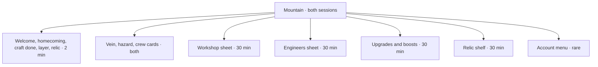

# Screen audit

Measured on the running game at 390×844, 360×640 and 360×560, portrait, device scale 2. Nothing in this sitting changes styles, layout, copy or play. `#234` is the token pass. `#230` (M11) is where teaching copy belongs.

Shots live in [`docs/ui-audit/`](ui-audit/). Each file is `<screen>-<state>-<WxH>.png`.

Bars used below:

- Touch targets 48×48px, with 8px between them. [WCAG 2.5.8](https://www.w3.org/WAI/WCAG22/Understanding/target-size-minimum.html) asks only 24×24 at AA. [Apple HIG accessibility](https://developer.apple.com/design/human-interface-guidelines/accessibility) asks 44×44pt. 48px is the bar this milestone already picked, and it matches a Material touch target.
- Body text 4.5:1, large text and controls 3:1. [WCAG 1.4.3](https://www.w3.org/WAI/WCAG22/Understanding/contrast-minimum.html). Large text here means 24px, or 18.66px at weight 700 or more.
- Spacing on a 4px grid. [Material 3 layout](https://m3.material.io/foundations/layout/understanding-layout/spacing) uses a 4dp step for the same reason: thumbs and type line up.
- No scroll at 360×560. The page (`html` and `#app`) never scrolls. Five sheets do.

## Screens

| Screen                   | 390×844                                             | 360×640                                             | 360×560                                             | What is wrong                                                                                                                                                           |
| ------------------------ | --------------------------------------------------- | --------------------------------------------------- | --------------------------------------------------- | ----------------------------------------------------------------------------------------------------------------------------------------------------------------------- |
| Mountain at rest         | [shot](ui-audit/mountain-rest-390x844.png)          | [shot](ui-audit/mountain-rest-360x640.png)          | [shot](ui-audit/mountain-rest-360x560.png)          | Crew rates at 8.32px collide on the drill, borer and machine cards. Header buttons are 44px and 4px apart.                                                              |
| Golden vein              | [shot](ui-audit/mountain-vein-390x844.png)          | [shot](ui-audit/mountain-vein-360x640.png)          | [shot](ui-audit/mountain-vein-360x560.png)          | Same mountain, plus the vein. Its box overlaps the mountain button (gap 0).                                                                                             |
| Hazard                   | [shot](ui-audit/mountain-hazard-390x844.png)        | [shot](ui-audit/mountain-hazard-360x640.png)        | [shot](ui-audit/mountain-hazard-360x560.png)        | Cave-in replaces the cart rate. The shout is readable. The other cards stay at 8.32px.                                                                                  |
| Next-layer hint          | [shot](ui-audit/mountain-layer-hint-390x844.png)    | [shot](ui-audit/mountain-layer-hint-360x640.png)    | [shot](ui-audit/mountain-layer-hint-360x560.png)    | Hint is 14.4px and vague on purpose. It shares the header with the relic line, so two hints compete.                                                                    |
| Crew, needs workers      | [shot](ui-audit/crew-needs-workers-390x844.png)     | [shot](ui-audit/crew-needs-workers-360x640.png)     | [shot](ui-audit/crew-needs-workers-360x560.png)     | Drill reads `Needs 3 workers · 2 free` at 8.32px / line-height 8.49px. The open worker line is 43.1px tall. The machine card is greyed because the next one costs 268M. |
| Material chips           | [shot](ui-audit/material-chips-390x844.png)         | [shot](ui-audit/material-chips-360x640.png)         | [shot](ui-audit/material-chips-360x560.png)         | Clay, iron, crystal and heartstone show real counts. The row uses a 2px gap and wraps under the pocket.                                                                 |
| Upgrades and boosts      | [shot](ui-audit/upgrades-boosts-timer-390x844.png)  | [shot](ui-audit/upgrades-boosts-timer-360x640.png)  | [shot](ui-audit/upgrades-boosts-timer-360x560.png)  | Sheet scrolls 129px (689 > 560). Running timers (`Running · 10:00`, `Running · 30:00`) sit in the top third at 360×640. Buy buttons are 44px tall and 1px apart.        |
| Workshop, bench idle     | [shot](ui-audit/workshop-idle-390x844.png)          | [shot](ui-audit/workshop-idle-360x640.png)          | [shot](ui-audit/workshop-idle-360x560.png)          | Real prices (`Craft · 500K`). Craft buttons are 146×44. Reached only from the menu.                                                                                     |
| Workshop, crafting       | [shot](ui-audit/workshop-crafting-390x844.png)      | [shot](ui-audit/workshop-crafting-360x640.png)      | [shot](ui-audit/workshop-crafting-360x560.png)      | Bench timer is a real clock. Cancel names the refund (`250K stones, 10 clay, and 4 iron`).                                                                              |
| Workshop, cancel confirm | [shot](ui-audit/workshop-cancel-390x844.png)        | [shot](ui-audit/workshop-cancel-360x640.png)        | [shot](ui-audit/workshop-cancel-360x560.png)        | Second tap says `Tap again to cancel`. Same 44px button, no separate sheet.                                                                                             |
| Workshop, reinforce      | [shot](ui-audit/workshop-reinforce-390x844.png)     | [shot](ui-audit/workshop-reinforce-360x640.png)     | [shot](ui-audit/workshop-reinforce-360x560.png)     | Shows the real machine rates and `5 iron`. The button says `Craft` because the stone price is 0.                                                                        |
| Workshop, axle grease    | [shot](ui-audit/workshop-axle-grease-390x844.png)   | [shot](ui-audit/workshop-axle-grease-360x640.png)   | [shot](ui-audit/workshop-axle-grease-360x560.png)   | Shows `1 iron` and `10 min`. Pager buttons are 44px and 4px from Close.                                                                                                 |
| Workshop, need more      | [shot](ui-audit/workshop-need-more-390x844.png)     | [shot](ui-audit/workshop-need-more-360x640.png)     | [shot](ui-audit/workshop-need-more-360x560.png)     | Greyed `Need 4 more iron` and `Need 1 more iron` on `.workshop-craft.is-short`. Still 44px tall.                                                                        |
| Craft done               | [shot](ui-audit/workshop-craft-done-390x844.png)    | [shot](ui-audit/workshop-craft-done-360x640.png)    | [shot](ui-audit/workshop-craft-done-360x560.png)    | Notice names the fit and a real rate. One button, in the thumb zone.                                                                                                    |
| Engineers, promote       | [shot](ui-audit/engineers-promote-390x844.png)      | [shot](ui-audit/engineers-promote-360x640.png)      | [shot](ui-audit/engineers-promote-360x560.png)      | Price is real (`Promote: 2M stones`). The reason is 12px. A large empty band sits between Ada and the promote row.                                                      |
| Engineers, expedition    | [shot](ui-audit/engineers-expedition-390x844.png)   | [shot](ui-audit/engineers-expedition-360x640.png)   | [shot](ui-audit/engineers-expedition-360x560.png)   | Ada is out. The line is words (`about an hour`), not a clock. That matches the discovery rule.                                                                          |
| Engineers, homecoming    | [shot](ui-audit/engineers-homecoming-390x844.png)   | [shot](ui-audit/engineers-homecoming-360x640.png)   | [shot](ui-audit/engineers-homecoming-360x560.png)   | `Welcome home` names who came back and what they carried. No digits, on purpose.                                                                                        |
| Relic tease              | [shot](ui-audit/relic-tease-390x844.png)            | [shot](ui-audit/relic-tease-360x640.png)            | [shot](ui-audit/relic-tease-360x560.png)            | `Next: Mantle of the Hero · Almost there` at 13.6px. Vague depth is correct. It is not a next action.                                                                   |
| Relic reveal             | [shot](ui-audit/relic-reveal-390x844.png)           | [shot](ui-audit/relic-reveal-360x640.png)           | [shot](ui-audit/relic-reveal-360x560.png)           | Scrolls 65px (625 > 560). The continue button is in the bottom half.                                                                                                    |
| Relic shelf              | [shot](ui-audit/relic-shelf-390x844.png)            | [shot](ui-audit/relic-shelf-360x640.png)            | [shot](ui-audit/relic-shelf-360x560.png)            | Scrolls 129px (689 > 560). Unfound rows use the tease line. The shelf button on the mountain is only 44px tall.                                                         |
| Legacy badge             | [shot](ui-audit/legacy-badge-390x844.png)           | [shot](ui-audit/legacy-badge-360x640.png)           | [shot](ui-audit/legacy-badge-360x560.png)           | `Legacy ×1.1` is 12.8px on the crowded header.                                                                                                                          |
| Pass the mine            | [shot](ui-audit/legacy-pass-390x844.png)            | [shot](ui-audit/legacy-pass-360x640.png)            | [shot](ui-audit/legacy-pass-360x560.png)            | Menu scrolls 37px once the pass row is added (597 > 560).                                                                                                               |
| Pass confirm             | [shot](ui-audit/legacy-confirm-390x844.png)         | [shot](ui-audit/legacy-confirm-360x640.png)         | [shot](ui-audit/legacy-confirm-360x560.png)         | Title is `Pass the mine to your kid?`. The question mark is the sharp note. The stakes are written in full.                                                             |
| Welcome back             | [shot](ui-audit/welcome-back-390x844.png)           | [shot](ui-audit/welcome-back-360x640.png)           | [shot](ui-audit/welcome-back-360x560.png)           | Real stones gained. The continue button is in the bottom half. This is the 2-minute door.                                                                               |
| Layer arrival            | [shot](ui-audit/layer-arrival-390x844.png)          | [shot](ui-audit/layer-arrival-360x640.png)          | [shot](ui-audit/layer-arrival-360x560.png)          | Names the band and the feel of it. No depth number. Fits.                                                                                                               |
| Menu                     | [shot](ui-audit/menu-game-390x844.png)              | [shot](ui-audit/menu-game-360x640.png)              | [shot](ui-audit/menu-game-360x560.png)              | Scrolls 3px (563 > 560). Workshop is a second tap. Saved copies and Start over are 13.6px underlined links, 44px tall.                                                  |
| Field log                | [shot](ui-audit/field-log-390x844.png)              | [shot](ui-audit/field-log-360x640.png)              | [shot](ui-audit/field-log-360x560.png)              | A log for a person, not a decision. Fine tucked in the menu.                                                                                                            |
| Start over confirm       | [shot](ui-audit/start-over-confirm-390x844.png)     | [shot](ui-audit/start-over-confirm-360x640.png)     | [shot](ui-audit/start-over-confirm-360x560.png)     | Title is `Start over?`. Buttons are clear. It is a second sheet on top of the menu.                                                                                     |
| Save: sign in            | [shot](ui-audit/save-status-unsigned-390x844.png)   | [shot](ui-audit/save-status-unsigned-360x640.png)   | [shot](ui-audit/save-status-unsigned-360x560.png)   | `Sign in to save` at 16px. Same line for every state, which is good.                                                                                                    |
| Save: this device        | [shot](ui-audit/save-status-session-390x844.png)    | [shot](ui-audit/save-status-session-360x640.png)    | [shot](ui-audit/save-status-session-360x560.png)    | `Saved on this device`.                                                                                                                                                 |
| Save: loading            | [shot](ui-audit/save-status-loading-390x844.png)    | [shot](ui-audit/save-status-loading-360x640.png)    | [shot](ui-audit/save-status-loading-360x560.png)    | `Loading your save...`                                                                                                                                                  |
| Save: account            | [shot](ui-audit/save-status-account-390x844.png)    | [shot](ui-audit/save-status-account-360x640.png)    | [shot](ui-audit/save-status-account-360x560.png)    | `Saved to your account`.                                                                                                                                                |
| Save: unreachable        | [shot](ui-audit/save-status-error-390x844.png)      | [shot](ui-audit/save-status-error-360x640.png)      | [shot](ui-audit/save-status-error-360x560.png)      | `Couldn't reach your save`. Honest, not a scold.                                                                                                                        |
| Two saves, at rest       | [shot](ui-audit/save-conflict-rest-390x844.png)     | [shot](ui-audit/save-conflict-rest-360x640.png)     | [shot](ui-audit/save-conflict-rest-360x560.png)     | Real depths and pockets. Phone card starts selected. Fits at 560. Own card chrome.                                                                                      |
| Two saves, other card    | [shot](ui-audit/save-conflict-selected-390x844.png) | [shot](ui-audit/save-conflict-selected-360x640.png) | [shot](ui-audit/save-conflict-selected-360x560.png) | The other device card takes the gold border. Same sheet.                                                                                                                |
| Saved copies             | [shot](ui-audit/saved-copies-earlier-390x844.png)   | [shot](ui-audit/saved-copies-earlier-360x640.png)   | [shot](ui-audit/saved-copies-earlier-360x560.png)   | One row is greyed: `From an earlier run – can't be played now`. The other can still be played.                                                                          |
| Playing in another tab   | [shot](ui-audit/other-tab-playing-390x844.png)      | [shot](ui-audit/other-tab-playing-360x640.png)      | [shot](ui-audit/other-tab-playing-360x560.png)      | Own card and `.other-tab-play`, not the shared `.go` button. Copy is gentle.                                                                                            |
| Update available         | [shot](ui-audit/update-available-390x844.png)       | [shot](ui-audit/update-available-360x640.png)       | [shot](ui-audit/update-available-360x560.png)       | Own `.update-card` and `.update-reload`. One job: reload.                                                                                                               |

## Inconsistencies

Counts are from the 360×560 and 390×844 shots, top layer only (a sheet hides the mountain under it). Touch, scroll and thumb notes are the sizes named in each heading.

### Type

27 sizes and 63 size/weight/line-height pairs. Weights in use: 400, 500, 650, 700, 800. Anything under 14px is flagged. The worst line-height is 8.49px on 8.32px type (about 1.02).

| Size    | Weight | Line height | Selector                                               | Sample                                      | Times seen |
| ------- | ------ | ----------- | ------------------------------------------------------ | ------------------------------------------- | ---------- |
| 8.32px  | 650    | 8.49px      | `[data-tier="drill"] .tier-rate` (also borer, machine) | `+198 · 1,588/s · Needs 3 workers · 2 free` | 78         |
| 8.32px  | 800    | 11.23px     | `[data-tier="drill"] .engineer-gain`                   | `+1,181 stones/sec`                         | 56         |
| 10.24px | 650    | 11.78px     | `[data-tier="helper"] .tier-rate` (cart, kid)          | `+2.5 · 203/s`                              | 86         |
| 11.20px | 650    | 12.88px     | `[data-tier="helper"] .tier-rate`                      | `+1/s each`                                 | 2          |
| 12px    | 400    | normal      | `.engineer-rank-word`, `.engineer-trip-detail`         | `Apprentice`                                | 6          |
| 12px    | 700    | 15px        | `.engineer-promote-title`                              | `Promote a worker`                          | 4          |
| 12px    | 400    | 15px        | `.engineer-promote-why`                                | `A new engineer can tend another machine…`  | 4          |
| 12.48px | 400    | 14.35px     | `[data-tier="helper"] span` (the cost)                 | `1.1B`                                      | 166        |
| 12.8px  | 800    | 15.36px     | `.tier-count`                                          | `×80`                                       | 164        |
| 12.8px  | 700    | normal      | `.legacy-badge`, `.shelf-hint`                         | `Legacy ×1.1`                               | 6          |
| 13.12px | 700    | 15.09px     | `.tier-name`                                           | `Worker`                                    | 166        |
| 13.6px  | 400    | normal      | `.goal`, `.start-over-link`, `.saved-copies-link`      | `Next: Mantle of the Hero · Getting closer` | 23         |

At or above 14px the useful steps are 14.4 (workshop and upgrade body, 718 nodes), 16 (`.save-status` and `.label`), 18 and 19.5 (`.stones-left`, it jumps with the viewport), 20 (sheet titles and the big continue buttons), 24 (welcome, reveal and menu titles). The welcome stone count is 39.2px at 360 and 46.8px at 390. Rules live in `src/style.css` (`.tier-rate` at 0.58rem and 0.64rem, `.tier-name` at 0.82rem).

### Spacing

Values that are not multiples of 4. Flex `auto` margins on `.menu-button` (24px to 137px) are layout leftovers, not tokens, and are left out.

| Value  | Property              | Selector                                        | Times seen |
| ------ | --------------------- | ----------------------------------------------- | ---------- |
| −6px   | margin top and bottom | `.pocket-actions`                               | 60         |
| 1px    | padding               | `.menu-button`, `.tier-count`                   | 528        |
| 1px    | gap                   | `.upgrade-list`                                 | 36         |
| 2px    | gap                   | `.pocket-stack`, `.material-line`, `#app`       | 338        |
| 2px    | padding               | `.crew-posts`, `.upgrades-card`, `.upgrade-buy` | 112        |
| 3px    | gap                   | `.tier-cost`                                    | 516        |
| 6px    | padding and gap       | `.tier`, `.relic-shelf`, `.tier-grid`           | 1266       |
| 6.72px | gap                   | `.shelf-list`                                   | 3          |
| 7px    | padding               | `.tier-count`                                   | 328        |
| 10px   | padding and gap       | `#app`, `.relic-shelf`, `.shelf-list`           | 107        |
| 13.5px | gap                   | `#app`                                          | 45         |

6px and 10px are the ones that show up everywhere. 14px padding on `.notice-card` is on the grid. The rest should collapse to 4 or 8.

### Colours

Solid text that was measured passed the bar: 4.5:1 for body, 3:1 for controls and large text. No failing pair was recorded on an opaque fill.

The quiet links are the close call. `.start-over-link` and `.saved-copies-link` in `src/style.css` are `#8a7258` on the card `#1e130d`. That pair is 4.01:1 at 13.6px. As buttons they clear 3:1. Read as body, they miss 4.5:1.

The 2px tier border `#6b4a2a` (`rgb(107, 74, 42)`, `.tier` in `src/style.css`) against the card `#1e130d` is 2.29:1, under 3:1 for a control edge.

Near-duplicate fills, RGB distance under 28. These are the night browns that should be one or two roles:

| A         | B         | Distance | Uses |
| --------- | --------- | -------- | ---- |
| `#1e130d` | `#1c120c` | 2.4      | 828  |
| `#120c0a` | `#140d09` | 2.4      | 758  |
| `#c9b391` | `#c9b08e` | 4.2      | 126  |
| `#3a2a1c` | `#392816` | 6.4      | 26   |
| `#120c0a` | `#1c120c` | 11.8     | 778  |
| `#1e130d` | `#2a1a10` | 14.2     | 2408 |

`#2a1a10` is the disabled fill (`.tier:disabled`, `.upgrade-buy:disabled`). `#3a2a1c` is the greyed craft (`.workshop-craft.is-short`). They are doing the same job.

### Radii and borders

Eight radii. 12px is the workhorse (`.tier`, `.workshop-card`, 452 nodes). Pills are `999px` on `.tier-count` and `.guide-bar` (258) and `50%` on `.engineer-mark` and `.lamp` (82). Then 10px (`.menu-button`, `.workshop-craft`), 16px (`.mountain`), 20px (`.menu-card`, `.welcome-card`, `.upgrades-card`), 14px (`.engineer`), `16px 16px 0 0` on `.sheet.card`, and `27px 27px 0 0` on `.engineer-tunnel`.

Borders are 1px or 2px. The repeated ones are `2px solid rgb(107, 74, 42)` on `.tier` and `.workshop-card` (176), `2px solid rgb(30, 19, 13)` on `.tier-count` (168), and `2px solid rgb(242, 196, 109)` on the needs-workers card (132). One-offs: dashed `#8a6a3a` on `.engineer-promote-row`, red `rgb(192, 57, 43)` on `.start-over-card`, and `rgb(231, 76, 60)` on `.start-over-confirm`.

### Touch targets at 360×560

Height is the failure. Width is usually fine. 48px is the bar.

| Box       | Selector                                | Label                              |
| --------- | --------------------------------------- | ---------------------------------- |
| 44×44     | `.menu-button`                          | ☰                                 |
| 44×44     | `.engineers-button`, `.upgrades-button` | icons                              |
| 44×44     | `.engineers-close`                      | ×                                  |
| 220×44    | `.relic-shelf`                          | the shelf                          |
| 328×44    | `.crew-posts`                           | `84 workers · 2 free`              |
| 321×43.1  | `.crew-posts.is-open`                   | same line, opened                  |
| 146×44    | `.workshop-craft`                       | `Craft · 500K`, `Need 1 more iron` |
| 44px tall | `.upgrade-buy`                          | `Buy · 5.7M`, `Running · 10:00`    |
| 157×44    | `.engineer-act`                         | `Tend a machine`, `Send exploring` |
| 114×44    | `.saved-copies-link`                    | Saved copies                       |
| 94×44     | `.start-over-link`                      | Start over                         |

Closer than 8px on the mountain at rest:

- `.engineers-button` and `.mountain`, gap 0. The portraits sit on the mountain's tap box.
- `.crew-posts` and the first `.tier`, gap 0.
- `.engineers-button` and `.upgrades-button`, gap 4px.
- `.relic-shelf` and `.mountain`, gap 2px.
- Neighbouring `.tier` cards, gap 6px.

On the upgrades sheet the buy buttons are 1px apart (`[data-upgrade="tap"] .upgrade-buy` and `[data-upgrade="boots"] .upgrade-buy`). On the workshop the pager is 4px from `.workshop-close`, and a recipe button meets `.workshop-more` at gap 0.

### Thumb reach at 360×640, and scroll at 360×560

Primary actions in the top third (center above 213px) are the upgrade buys: `Running · 10:00` and `Running · 30:00` at centerY 87, `Buy · 5.7M` at 148, `Owned` at 193. The sheet's own close button is in the bottom half. The decision is not.

Every open sheet's main button is in the bottom half of the screen. These sheets still scroll (`scrollHeight` greater than `clientHeight`):

| Sheet                           | scrollHeight | clientHeight | Overflow |
| ------------------------------- | ------------ | ------------ | -------- |
| `.upgrades-dialog`              | 689          | 560          | 129      |
| `.shelf-dialog`                 | 689          | 560          | 129      |
| `.relic-reveal`                 | 625          | 560          | 65       |
| `.game-menu` with Pass the mine | 597          | 560          | 37       |
| `.game-menu`                    | 563          | 560          | 3        |

`html` and `#app` do not scroll on any shot.

### Components

Counted on the top layer at 360×560.

- Cards, 16 class variants: `.tier` (72), `.workshop-card` (24), `.upgrade` (11), `.menu-card` (4), `.save-card` (4), `.welcome-card`, `.reveal-card`, `.layer-card`, `.notice-card`, `.engineer`, `.shelf-card`, `.start-over-card`, `.legacy-card`, `.saved-copy`, `.other-tab-card`, `.update-card`.
- Buttons, 52 class strings. The families are `.tier`, `.upgrade-buy`, `.workshop-craft` (plus `is-short`, `is-waiting`, `is-on-bench`), `.engineer-act`, `.menu-close`, and `.go`. The save screens add one-offs: `.other-tab-play`, `.update-reload`, and `.save-card` (the conflict button does use `.go.save-conflict-play`). `.auth-action`, `.workshop-open`, `.field-log-copy`, `.legacy-confirm` and `.start-over-confirm` are also their own shapes.
- Chips, 4: `.material-bit`, `.cost-bit`, `.boost-chip`, `.expedition-chip`.
- Timers, 3: `.workshop-timers` (a clock), `.workshop-bar`, and the boost row `Running · mm:ss`. The expedition chip is words, not a clock.
- Notices, 4: `.welcome-back`, `.craft-notice`, `.layer-arrival`, and the reveal card (it uses `.reveal-card`, not the notice class).
- Badges, 4: `.tier-count`, `.engineer-mark`, `.engineer-badge`, `.legacy-badge`.

The three save screens from `#254` and `#255` do not share one card. `.other-tab-card` and `.update-card` copy the 20px gold card by hand. `.save-conflict-sheet` is in that same CSS list, then `.save-card` adds a second selected border. `.other-tab-play` and `.update-reload` are not `.go`.

### Copy

Player text with `?`, both in `src/menu-panel.ts` and `src/legacy-panel.ts`:

- `#start-over-title`: `Start over?`
- `#legacy-title`: `Pass the mine to your kid?`

Purchases, tending and crafting show real numbers: `Buy · 5.7M`, `Craft · 500K`, `Promote: 2M stones`, `Needs 3 workers · 2 free`, `Cancel · 250K stones, 10 clay, and 4 iron`, `Running · 10:00`, `+177 stones/sec`. `Craft` with no digit is only used when the stone price is 0. The cost line next to it still says `5 iron` or `1 iron`.

Vague on purpose, and matching the discovery rule: relic hints (`Almost there`, `Getting closer`), the layer line (`Deeper on, the walls start to glitter.`), expedition time (`about an hour`), and homecoming finds. The hazard shout is `Cave-in!` with no timer.

Off the uplifting tone: the two question-mark titles. They ask the dad to doubt a rare, serious button. The rest of the copy is warm (`The bench is free`, `A little at a time is plenty.`, `nothing is lost`).

There is no line that says what to do next. `.goal` is a relic hint, not the next purchase.

## Information architecture

A session is either about 2 minutes (look, one decision, leave) or about 30 minutes (plan, craft, send people out, tune the crew). The short path has to stay short. The long path needs depth that is one tap away, and that depth must not sit on the mountain while he is only checking in.

Idle games that last keep one board on screen (the mountain is that board) and put the craft behind a single panel each. Material 3 puts the primary action in the bottom half and uses one sheet at a time. Apple's HIG asks for the same: one clear action, targets the thumb can hit, no extra confirm for a thing he does every night.

### What exists today

Taps are from the mountain, with nothing else open.

| Surface                                                                        | Taps                       | What he decides                                         |
| ------------------------------------------------------------------------------ | -------------------------- | ------------------------------------------------------- |
| Mountain, vein, hazard, chips, save line, relic hint, layer hint, legacy badge | 0                          | Tap the rock, tap the vein, or buy a crew card.         |
| Crew cards and the worker line                                                 | 0, or 1 to expand the line | Buy the next worker or machine.                         |
| Welcome back, homecoming, craft-done, layer card, relic reveal                 | 0 (they open themselves)   | Read it and go back. One button.                        |
| Upgrades and boosts                                                            | 1                          | Buy a lasting upgrade or start a boost.                 |
| Engineers                                                                      | 1                          | Tend, send, recall, or promote.                         |
| Relic shelf                                                                    | 1                          | Read a relic. No purchase.                              |
| Menu                                                                           | 1                          | Sign in, or pick a buried tool.                         |
| Workshop                                                                       | 2 (menu, then Workshop)    | Craft, wait, or cancel.                                 |
| Field log                                                                      | 2                          | Copy a log. No game decision.                           |
| Saved copies                                                                   | 2                          | Play an old copy, or see that an earlier run is locked. |
| Start over, and its confirm                                                    | 2, then a confirm          | Throw the run away.                                     |
| Pass the mine, and its confirm                                                 | 2, then a confirm          | End the mountain.                                       |
| Two saves found                                                                | 0 when the cloud disagrees | Pick a save.                                            |
| Other tab, update                                                              | 0 when they happen         | Play here, or reload.                                   |

### Keep, merge, demote, remove

| Surface                                    | 2-minute check-in                    | 30-minute sitting                    | Why                                                                                                  |
| ------------------------------------------ | ------------------------------------ | ------------------------------------ | ---------------------------------------------------------------------------------------------------- |
| Mountain and crew cards                    | Keep                                 | Keep                                 | This is the board. Collect and the one buy both live here.                                           |
| Welcome and homecoming                     | Keep                                 | Keep, but don't block the long tools | The check-in. One button, then the mountain.                                                         |
| Vein and hazard                            | Keep                                 | Keep                                 | One tap, on the board. Missing them costs nothing.                                                   |
| Craft-done and layer card                  | Keep                                 | Keep                                 | One beat each. They already get out of the way.                                                      |
| Relic reveal                               | Keep                                 | Keep                                 | Once per relic. The 65px scroll at 560 should go, not the card.                                      |
| Upgrades                                   | Demote the entry to a quiet icon     | Keep as one sheet                    | The long sitting needs it in one tap. It must not scroll, and the timer must sit in the bottom half. |
| Workshop                                   | Hide from the check-in               | Keep, and open it from the mountain  | Today it is two taps and lives in the menu, so a half hour starts with hunting.                      |
| Engineers                                  | Hide from the check-in               | Keep as one sheet                    | Tending and expeditions are the long sitting. Promote stays on that sheet.                           |
| Relic shelf                                | Demote to the header                 | Keep                                 | Lovely, not a decision. It should not scroll, and it should not compete with the next buy.           |
| Relic hint and layer hint                  | Merge into one quiet line            | Same                                 | Two hints in the header, and neither says what to tap.                                               |
| Menu                                       | Demote                               | Demote                               | Account, field log, saved copies, start over. Not Workshop.                                          |
| Field log                                  | Demote                               | Demote                               | A tool for a person, not a night's play.                                                             |
| Saved copies, two saves, other tab, update | Keep off the happy path              | Keep off the happy path              | They show up when something is wrong. They should wear the same card and the same button.            |
| Start over and pass confirm                | Keep behind the menu                 | Keep behind the menu                 | Rare and serious. One confirm is enough. Drop the question mark.                                     |
| Legacy badge                               | Demote to the menu or the pass sheet | Same                                 | A ×1.1 chip in the header is noise on a Tuesday.                                                     |
| Empty band on the engineers sheet          | Remove the gap                       | Remove the gap                       | The promote row can sit under Ada. The sheet already has the decision.                               |

### What is missing

- A single "what to do next" on the mountain: the next buy or the next craft, with the real price. The relic line does not do that job.
- How it works. Nothing in the game teaches layers, staffing, tending or expeditions. That copy is M11 (`#242`, `#243`, `#246`), on a shared teach component (`#241`). It should open from the sheet it explains (one info button on Workshop, one on Engineers), not a new screen and not a paragraph on the mountain. The 2-minute path never needs it. The 30-minute path needs it the first time, then it gets out of the way.

### Target map

One level of sheets over the mountain. Nothing in this map scrolls at 360×560. The check-in never has to open a sheet.

Top 5 actions, 2 minutes:

1. See what the crew did. Already open. 0 taps.
2. Dismiss it. 1 tap.
3. Tap the vein, or the mountain. 1 tap.
4. Buy the crew card the board already shows, if he wants. 1 tap.
5. Leave. 0 taps.

Top 5 actions, 30 minutes:

1. Open the workshop. 1 tap from the mountain. Today it is 2.
2. Start or collect a craft. 1 more tap. The price is on the button.
3. Open engineers and send or tend. 1 tap to the sheet, 1 tap to the choice.
4. Open upgrades and buy or boost. 1 tap to the sheet, 1 tap to buy. The buy sits in the bottom half.
5. Glance at the shelf. 1 tap, and it fits.

## Proposed tokens

For `#234`. Not applied here.

- Type: 14, 16, 20, 24, 32. Weight 400 or 700. Line height 1.3. Nothing under 14. The 8.32px rate line is the one that has to move first.
- Space: 4 and 8, then 16 and 24. Drop 1, 2, 3, 6, 7 and 10.
- Colour roles: page, card, ink, quiet, gold, ink-on-gold, danger. One disabled fill. The night browns within distance 15 become two colours, not six.
- Radii: 12 on controls, 20 on sheets, a pill only for a count badge.
- Targets: 48×48 minimum, 8px apart. The 44px header, craft and buy buttons are the list. Primary buys sit in the bottom half. Sheets fit at 360×560, so the upgrades sheet and the shelf stop scrolling.

## Design direction

Flemming on the first token mocks: better, and not yet a crisp night. The notes below are the rules for three later mocks (`mountain-a` with `upgrades-a`, `mountain-b` with `upgrades-b`, `mountain-c` with `upgrades-c`). Still mocks. The game styles stay put.

Looked at Cookie Clicker, Egg Inc, AdVenture Capitalist, Idle Miner Tycoon, Melvor Idle, and Universal Paperclips, plus the touch research already behind the 48px bar. Nine rules:

1. **One hero number, and the rate tucked under it.** Cookie Clicker's eye lands on the Big Cookie, then the bank and the cookies-per-second line beside it. The count and the rate are one thought. The next buy is the only other number at that volume. ([Big Cookie](https://cookieclicker.wiki.gg/wiki/Big_Cookie), [a walkthrough of that screen](https://steamcommunity.com/sharedfiles/filedetails/?id=2591407770))
2. **The picture is the tap, and the tap answers.** The Big Cookie shrinks for a moment and a number floats off it. Our press is that same physical inset, and the price stays on the button. The layout does not jump, so the 8px gap survives the press. Sound stays off until he unmutes.
3. **The buy sits where the thumb already is. The count can sit up high.** He plays one-handed: the phone stays in one hand, and the thumb taps the rock. Read-only lines (the pocket, the stones a second, the layer, the crew) sit at the top. The rock is large and in the lower middle. The buttons he hits sit along the bottom. A tall stack of buy cards pushes that rock out of reach, so direction B shows two answers. A short strip keeps the price, what one more adds, and `Needs N workers` one tap away, and the rock shares the lower half with those buttons. A bottom sheet leaves the rock filling the lower middle, and Buys is a bottom button that opens the cards over the lower screen. ([Hoober, UX Matters, 2013](https://www.uxmatters.com/mt/archives/2013/02/how-do-users-really-hold-mobile-devices.php), [Hoober, ACM Interactions, 2015](https://interactions.acm.org/archive/view/may-june-2015/fingers-thumbs-and-people), [thumb zones](https://gamedesign.gg/articles/mobile-game-ux-design/))
4. **An icon, a name, and one number.** Cookie Clicker's shop is a picture, a count, and a price, not a paragraph. A phone table that tries to show every column becomes a squint. The name stays, because a bare sprite is not a sentence. The sentence does not.
5. **Numbers use tabular figures.** Each digit takes the same width, so a ticking counter does not wobble. `font-variant-numeric: tabular-nums`. ([MDN](https://developer.mozilla.org/en-US/docs/Web/CSS/Reference/Properties/font-variant-numeric))
6. **One gold control.** The affordable next buy is the gold fill. Everything he cannot buy yet uses the one disabled fill, or it leaves the check-in entirely. Two gold buttons is two decisions.
7. **Two sessions, two depths.** A two-minute open shows the hero number, the picture, and one buy, then he is gone. A thirty-minute sitting opens Workshop, Engineers, or Upgrades with one thumb tap, and that sheet fits. Portrait is the interruptible shape. ([sessions and portrait](https://gamedesign.gg/articles/mobile-game-ux-design/), and the target map above)
8. **Whitespace is the hierarchy.** Six equal cards make every fact shout. One frame, one gold button, and quiet type for the rest. The 8px gap and the 16px pause around the hero are doing that work. ([Material spacing](https://m3.material.io/foundations/layout/understanding-layout/spacing), [48px targets](https://m3.material.io/foundations/designing/structure))
9. **Free hands are counted once.** Spare workers are one pool, so the crew line is the only place that says how many are free. A buy card says what that one machine needs (`Needs 3 workers`) and stops there.
